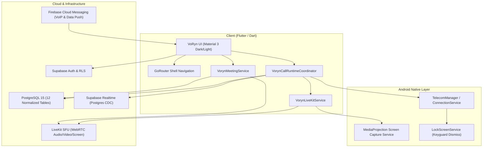

<div align="center">

  

  # VoRyn

  **Connect your way.**

  An enterprise-grade, privacy-first real-time communication platform built with Flutter, Supabase, LiveKit SFU, and WebRTC.

  [](https://flutter.dev)
  [](https://dart.dev)
  [](https://supabase.com)
  [](https://livekit.io)
  []()
  [](#testing--quality-assurance)
  [](LICENSE)

</div>

---

## 📖 Overview

**VoRyn** is a modern, high-performance communication suite designed to deliver crystal-clear audio/video calling, dynamic multi-party conferences, interactive video meetings, and instant messaging. Engineered with strict architectural boundaries, native-first principles, and zero unnecessary bloatware, VoRyn pairs Flutter's reactive UI with Supabase's authoritative PostgreSQL backend and LiveKit's ultra-low latency WebRTC Selective Forwarding Unit (SFU).

---

## ✨ Key Features

### 📞 1-on-1 Direct Calling (Audio & Video)
- **Ultra-Low Latency:** Powered by LiveKit WebRTC with adaptive bitrate streaming.
- **Audio-to-Video Upgrade Handshake:** Authoritative peer-to-peer upgrade protocol with strict participant routing — requester enters waiting state while only the intended recipient receives the prompt.
- **In-Call Screen Sharing:** Native Android `MediaProjection` integration with a dedicated foreground service and dynamic remote surface rendering.
- **Full Lock-Screen Incoming Calls:** Native Android `ConnectionService` and `TelecomManager` integration (`VorynCallActivity`) wake the device with custom full-screen call alerts.
- **Persistent Mini Call Bar:** Minimize active calls to continue browsing chats, contacts, or history without interrupting audio or video.

### 👥 Merged Conference Calling
- **Merge 2 Active Calls:** Seamlessly merge an active call and a call-on-hold into a synchronized 3-way conference call.
- **Conference Coordinator:** Centralized state machine managing LiveKit session reuse, audio routing, speaker indicators, and participant leave/end lifecycles.

### 🌐 Collaborative Video Meetings
- **Instant & Scheduled Rooms:** Create or join meetings via 9-digit alphanumeric meeting codes or shareable links.
- **Pre-Join Green Room:** Test microphone, camera, and preview video feed before entering.
- **Dynamic Equal Grid (3+ Participants):** Mathematically optimized stage layout that partitions available screen space equally without black letterboxing voids across portrait and landscape viewports.
- **Spotlight & One-Tap PiP Switching:** Tap any participant's tile or PiP thumbnail to maximize them to fullscreen, while other participants dock into an interactive horizontal PiP deck.
- **"All Screens Equal" Mode:** One-tap toggle to immediately reset layout from spotlight mode to the dynamic equal grid.
- **Immersive View:** Single tap on video conceals headers and overlays for distraction-free meetings.
- **Host Privileges:** End meeting for everyone, manage participant audio/video tracks, and transfer host privileges.

### 💬 Real-Time Messaging & Conversations
- **Direct Chat Threads:** High-speed real-time messaging with instant delivery receipts and read indicators.
- **Message Actions:** Long-press to **Reply**, **Copy**, **Forward**, **Edit**, or **Delete** messages with a streamlined bottom action sheet.

### 🔍 Connect & Privacy-First Discovery
- **Exact Lookups:** Discover people exclusively via verified **Voryn ID** or normalized phone numbers.
- **No Contact Book Scraping:** Protects user privacy by preventing indiscriminate address book harvesting.
- **Quick Actions:** Initiate audio calls, video calls, messages, or save to contacts directly from user preview cards.

### 📋 History & Contact Management
- **Personal History Management:** Comprehensive call and meeting logs with multi-select batch deletion.
- **Contacts & Favorites:** Save frequent contacts and bookmark favorites with offline-first local persistence.
- **Do Not Disturb (DND) & Privacy:** Block, report, or silence incoming notifications with granular presence indicators.

---

## 🛠️ Architecture & Tech Stack



| Layer | Technologies |
|---|---|
| **Frontend Framework** | [Flutter 3.11+](https://flutter.dev) & [Dart 3.11+](https://dart.dev) |
| **State & Architecture** | Scoped Controllers, Notifiers, Strict Invariants |
| **Navigation** | [GoRouter 16.3+](https://pub.dev/packages/go_router) |
| **Media & WebRTC** | [LiveKit Client SDK 2.12+](https://pub.dev/packages/livekit_client), [flutter_webrtc](https://pub.dev/packages/flutter_webrtc) |
| **Backend & Database** | [Supabase](https://supabase.com) (PostgreSQL 15+, Row-Level Security, RPCs, Storage) |
| **Push Notifications** | [Firebase Cloud Messaging](https://firebase.google.com/docs/cloud-messaging) (`firebase_messaging`, `flutter_local_notifications`) |
| **Native Android** | Kotlin, `TelecomManager`, `ConnectionService`, `MediaProjection`, Foreground Services |
| **Local Storage** | `shared_preferences` with offline reconciliation |

---

## 📂 Project Structure

```text
voryn/
├── android/                 # Native Android configuration, Telecom service & MediaProjection
├── assets/                  # App branding, SVG logos, and vector assets
├── docs/                    # Architecture blueprints, protocol contracts & audit records
│   ├── MC_1_MERGE_CALLS_ARCHITECTURE.md
│   ├── MEET_1_MEETINGS_ARCHITECTURE.md
│   └── VORYN_MASTER_CONTEXT.md
├── lib/
│   ├── core/                # Theme tokens, utilities, and backend client bootstrap
│   ├── features/
│   │   ├── auth/            # Sign in, sign up, password recovery
│   │   ├── calling/         # 1-on-1 calls, group calls, LiveKit integration, PiP
│   │   ├── connect/         # Voryn ID and phone discovery hub
│   │   ├── contacts/        # Contact list, favorites, device sync
│   │   ├── meetings/        # Pre-join, meeting room, dynamic equal grid, host controls
│   │   ├── messages/        # Direct messaging, long-press actions, thread details
│   │   ├── onboarding/      # Welcome flow, phone verification, profile creation
│   │   ├── profile/         # Settings, presence, DND, themes
│   │   └── recents/         # Personal call history, multi-select deletion
│   └── shared/              # Reusable buttons, dialogs, sheets, bottom navigation shell
├── supabase/                # PostgreSQL migrations, RLS policies, and RPC definitions
└── test/                    # 390+ unit, widget, and integration test suite
```

---

## 🚀 Getting Started

### Prerequisites

1. **Flutter SDK:** `^3.11.5` ([Install Flutter](https://docs.flutter.dev/get-started/install))
2. **Android SDK / Studio:** API Level 34+ (Target SDK 35/36)
3. **Supabase Project:** Configured with migrations in `supabase/migrations/`
4. **LiveKit Cloud / Server:** Running instance with WebSocket URL & API credentials

### Installation

1. **Clone the repository:**
   ```bash
   git clone https://github.com/elvyntra/Voryn.git
   cd Voryn
   ```

2. **Install Flutter dependencies:**
   ```bash
   flutter pub get
   ```

3. **Configure Environment Variables:**
   Run or build the app by passing your Supabase and LiveKit credentials via `--dart-define`:
   ```bash
   flutter run \
     --dart-define=VORYN_SUPABASE_URL=https://<your-project>.supabase.co \
     --dart-define=VORYN_SUPABASE_ANON_KEY=<your-anon-key> \
     --dart-define=VORYN_LIVEKIT_URL=wss://<your-livekit-host>
   ```

---

## 🧪 Testing & Quality Assurance

VoRyn is built with continuous verification and reliability engineering:

```bash
# 1. Format code according to Dart conventions
dart format .

# 2. Run static analysis (0 errors, 0 lints)
flutter analyze

# 3. Execute the full test suite (390+ tests)
flutter test
```

### Key Automated Test Suites
- `test/meeting_equal_fullscreen_test.dart`: Validates Dynamic Equal Grid mathematics, fullscreen spotlighting, and PiP deck participant switching.
- `test/merged_conference_ui_test.dart`: Tests 3-way call merge transitions, controls hide/show, and participant lifecycle.
- `test/recents_meeting_message_actions_test.dart`: Validates multi-select personal history deletion and message long-press actions.
- `test/voryn_runtime_fix_3_test.dart`: Validates strict participant routing for audio-to-video upgrade handshakes.

---

## 📦 Building for Production

### Android Release APK
```bash
flutter build apk --release \
  --dart-define=VORYN_SUPABASE_URL=https://<your-project>.supabase.co \
  --dart-define=VORYN_SUPABASE_ANON_KEY=<your-anon-key>
```
The output will be generated at:
`build/app/outputs/flutter-apk/app-release.apk`

---

## 🛡️ Security & Privacy

- **Row-Level Security (RLS):** Every single database table has active PostgreSQL RLS policies ensuring users only access their own authorized records.
- **Non-Recursive RLS:** Safe participant evaluation prevents policy recursion in multi-user calling and meeting tables.
- **Biometric & Keyguard Privacy:** Complies with Android 14+ session restrictions, preventing unauthenticated screen capture.
- **No Third-Party Tracking:** Analytics and data collection are strictly zero by design.

---

## 📄 License

This project is licensed under the MIT License — see the [LICENSE](LICENSE) file for details.

<div align="center">
  <sub>Built with ❤️ by the VoRyn Team</sub>
</div>
