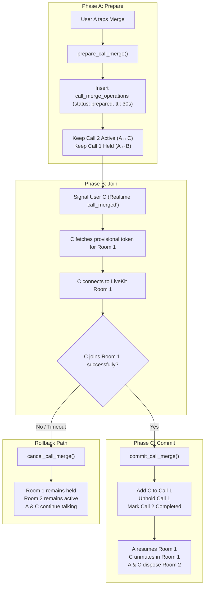

# VORYN — MERGE CALLS ARCHITECTURE SPECIFICATION (HARDENED)
**Checkpoint:** MC-1R  
**Status:** Architecture Specification — Hardened Two-Phase Commit  
**Target Platform:** Android + Web  

---

## 1. Executive Summary & Problem Scope

In Voryn's calling subsystem, a user (**User A**) connected to **User B** (**Call 1**) who accepts a waiting incoming call from **User C** (**Call 2**) via **Hold & Accept** enters a dual-session state:
- **Call 1 (A ↔ B):** Placed on hold. Audio and video tracks are suppressed.
- **Call 2 (A ↔ C):** Active conversation between A and C.

When User A taps **Merge Calls**, all three parties must transition into a single LiveKit conference room.

### The Single-Step Flaw (Identified in MC-1):
Completing the secondary call (Call 2) or permanently mutating the database before User C successfully joins the surviving LiveKit room makes **true rollback impossible**. If User C encounters a token failure, WebRTC handshake block, or network drop, Call 2 is already marked `completed` in the database, resulting in an unrecoverable call drop for User C.

### The Solution: Two-Phase Merge Protocol (Prepare $\rightarrow$ Join $\rightarrow$ Commit):
1. **Phase A (Prepare):** Create an expiring merge intention record. Authorize User C provisionally for the primary room. Keep Call 2 alive, active, and fully recoverable.
2. **Phase B (Join):** User C obtains a provisional LiveKit token and connects to the primary room in the background while Call 2 remains unmuted and active.
3. **Phase C (Commit):** Once User C's media connection in the primary room is confirmed, atomically commit the merge in Postgres: add User C permanently to Call 1, unhold Call 1, and close Call 2.



---

## 2. Audit of Existing Architecture

| Subsystem | Existing Implementation & Constraints | Hardened Merge Requirements |
| :--- | :--- | :--- |
| **`MultiCallCoordinator`** | Singleton managing `_sessionsByCallId`, `_activeCallId`, `_heldCallId`. Handles `holdAndAccept()`, `switchCalls()`, `endCall()`. Maintains max 2 active/held calls. | Manages the Two-Phase state machine (`idle` $\rightarrow$ `mergePreparing` $\rightarrow$ `authorizing` $\rightarrow$ `joiningConference` $\rightarrow$ `mergeCommitted` / `rollback`). |
| **`VorynCallRuntimeCoordinator`** | Per-call lifecycle controller (`forCall(callId)`). Protects active sessions against screen disposal during transitions via `isTransitioning`. Updates proximity and hardware routes. | Coordinates screen detachment/attachment when transitioning to `/group-call/:callId`. Prevents premature teardown of surviving room. |
| **`VorynLiveKitService`** | Wraps `livekit_client`. Manages connection, `hold()` (track suppression/disable), `resume()` (track re-enabling), audio route delegation. | Manages dual-session media transitions: prevents double microphone capture and echo while User C tests connection in Room 1. |
| **Database: `public.calls`** | Status constraint: `calling`, `ringing`, `connected`, `on_hold`, `completed`, `missed`, `declined`, `failed`, `cancelled`. Column `held_by` references user who held call. | Add nullable column `merged_into_call_id uuid references public.calls(id)` to link merged secondary calls to the canonical conference. |
| **Database: `call_participants`** | Junction table `(call_id, user_uid)` with `joined_at`, `left_at`, `muted`, `camera_enabled`. Protected by RLS using `is_call_participant()`. | User C is added permanently to Call 1 **only at Phase C (Commit)**. |
| **`call_merge_operations` (New)** | Dedicated intent table tracking merge lifecycle (`id`, `primary_call_id`, `secondary_call_id`, `initiated_by`, `target_user_uid`, `status`, `expires_at`, `committed_at`). | Serves as authoritative backend gate for provisional LiveKit token issuance and transactional idempotency. |
| **LiveKit Token Edge Function** | `supabase/functions/livekit-token/index.ts`. Checks `call_participants` using service role key for `(callId, user.id)`. Returns JWT for `voryn-call-${callId}`. | Updated to authorize provisional admission if an active, non-expired `call_merge_operations` record exists for `(callId, user.id)`. |
| **Call Escalation / Group UI** | `GroupCallScreen` (`/group-call/:callId`). Both `ActiveAudioCallScreen` and `ActiveVideoCallScreen` already have automatic escalation logic when remote participants > 1. | Active call UI navigates cleanly to `/group-call/${survivingCallId}` once merge is committed. |

---

## 3. Surviving Call Strategy

### Selected Model: Call 1 (A ↔ B) Survives; User C Migrates to Call 1

```mermaid
sequenceDiagram
    autonumber
    actor A as User A (Host)
    actor B as User B (Held)
    actor C as User C (Active)
    participant Backend as Postgres DB
    participant TokenService as livekit-token Edge Function
    participant LK1 as LiveKit Room 1 (Call 1)
    participant LK2 as LiveKit Room 2 (Call 2)

    Note over A,B: Room 1 connected (B held by A, audio suppressed)
    Note over A,C: Room 2 connected (active conversation)

    A->>Backend: prepare_call_merge(primary=Call 1, secondary=Call 2)
    Backend-->>Backend: Lock calls, create merge_op (status: prepared, ttl: 30s)
    Backend-->>A: { result: "prepared", merge_op_id: "...", primary_call_id: Call 1 }

    A->>C: Signaling (Realtime 'call_merged' { merge_op_id, primary_call_id })
    
    C->>TokenService: Request Token { callId: Call 1, mergeOpId: "..." }
    TokenService->>Backend: Verify active merge_op for User C
    Backend-->>TokenService: Verified (provisional admission)
    TokenService-->>C: LiveKit Token for Room 1 granted

    C->>LK1: Room.connect(Room 1) with muted mic
    Note over A,C: A & C still talk over Room 2 during join!
    
    LK1-->>C: Connected
    LK1-->>A: Remote participant C joined event

    A->>Backend: commit_call_merge(merge_op_id)
    Backend-->>Backend: Add C to Call 1, unhold Call 1, complete Call 2
    Backend-->>A: { result: "committed" }

    A->>LK1: session1.resume() (Unhold User B)
    C->>LK1: Unmute microphone in Room 1
    A->>LK2: session2.disconnect()
    C->>LK2: session2.disconnect()

    Note over A,B,C: All 3 participants now in Room 1 (Conference)
```

### Architectural Justification:
1. **Zero Disruption for Held Participant (User B):**
   - User B is already connected to LiveKit Room 1 (`voryn-call-{Call1}`).
   - User B requires zero network renegotiation, zero token re-issuance, and zero WebRTC reconnection.
   - User A simply resumes Room 1 media.
2. **100% Recoverable Secondary Call:**
   - Because Call 2 remains connected and active in Room 2 during User C's token fetch and Room 1 handshake, any failure in Phase B immediately aborts the merge without dropping the ongoing conversation between User A and User C.
3. **No Phantom Rooms:**
   - No temporary third room is created. Call 1 becomes the conference room.

---

## 4. Merge Intent Model (`call_merge_operations`)

### Schema Specification:
```sql
create table if not exists public.call_merge_operations (
  id uuid primary key default gen_random_uuid(),
  primary_call_id uuid not null references public.calls(id) on delete cascade,
  secondary_call_id uuid not null references public.calls(id) on delete cascade,
  initiated_by uuid not null references auth.users(id),
  target_user_uid uuid not null references auth.users(id),
  status text not null check (status in ('prepared', 'joining', 'committed', 'cancelled', 'expired')),
  created_at timestamptz not null default now(),
  expires_at timestamptz not null default (now() + interval '30 seconds'),
  committed_at timestamptz,
  constraint call_merge_distinct_calls check (primary_call_id <> secondary_call_id)
);

create index if not exists idx_call_merge_active 
  on public.call_merge_operations(primary_call_id, target_user_uid, status)
  where status in ('prepared', 'joining');
```

### Why a Dedicated Table is Strictly Superior:
1. **Schema Non-Invasiveness:** Modifying `public.calls.status` with intermediate states like `'merging'` would violate existing check constraints (`calls_status_check`) and break existing RLS policies and CDC filters across the codebase.
2. **Explicit TTL & Expiration:** Merge attempts have an explicit `expires_at` (30s). Stale or abandoned operations expire cleanly without leaving ghost state.
3. **Audit Trail:** Preserves exact records of who initiated the merge, who was migrated, and whether it succeeded or rolled back.

---

## 5. Atomic Backend RPCs

### 5.1 Phase A: `prepare_call_merge`
```sql
create or replace function public.prepare_call_merge(
  p_primary_call_id uuid,
  p_secondary_call_id uuid
)
returns jsonb
language plpgsql
security definer
set search_path = '' as $$
declare
  v_user_uid uuid := auth.uid();
  v_primary_call public.calls%rowtype;
  v_secondary_call public.calls%rowtype;
  v_target_user_uid uuid;
  v_distinct_count int;
  v_existing_op public.call_merge_operations%rowtype;
  v_merge_op_id uuid;
begin
  if v_user_uid is null then raise exception 'Authentication required'; end if;
  if p_primary_call_id is null or p_secondary_call_id is null then
    raise exception 'Call IDs cannot be null';
  end if;
  if p_primary_call_id = p_secondary_call_id then
    raise exception 'Primary and secondary call IDs must be distinct';
  end if;

  -- 1. Deterministic row locking to eliminate deadlocks
  perform 1 from public.calls
  where id in (p_primary_call_id, p_secondary_call_id)
  order by id for update;

  select * into v_primary_call from public.calls where id = p_primary_call_id;
  select * into v_secondary_call from public.calls where id = p_secondary_call_id;

  if v_primary_call.id is null or v_secondary_call.id is null then
    return jsonb_build_object('result', 'rejected', 'reason', 'call_not_found');
  end if;

  -- 2. Validate call states
  if v_primary_call.status not in ('connected', 'on_hold') or
     v_secondary_call.status not in ('connected', 'on_hold') then
    return jsonb_build_object('result', 'rejected', 'reason', 'calls_not_active');
  end if;

  -- 3. Validate initiator participates in both calls
  if not exists (select 1 from public.call_participants where call_id = p_primary_call_id and user_uid = v_user_uid and left_at is null) or
     not exists (select 1 from public.call_participants where call_id = p_secondary_call_id and user_uid = v_user_uid and left_at is null) then
    return jsonb_build_object('result', 'rejected', 'reason', 'unauthorized_participant');
  end if;

  -- 4. Idempotency: return active prepared operation if one already exists
  select * into v_existing_op from public.call_merge_operations
  where primary_call_id = p_primary_call_id 
    and secondary_call_id = p_secondary_call_id 
    and status in ('prepared', 'joining') 
    and expires_at > now();

  if v_existing_op.id is not null then
    return jsonb_build_object(
      'result', 'already_prepared',
      'merge_operation_id', v_existing_op.id,
      'primary_call_id', p_primary_call_id,
      'target_user_uid', v_existing_op.target_user_uid,
      'expires_at', v_existing_op.expires_at
    );
  end if;

  -- 5. Resolve migrating participant (User C)
  select user_uid into v_target_user_uid
  from public.call_participants
  where call_id = p_secondary_call_id and user_uid <> v_user_uid and left_at is null
  limit 1;

  if v_target_user_uid is null then
    return jsonb_build_object('result', 'rejected', 'reason', 'no_secondary_participant');
  end if;

  -- 6. Enforce participant capacity (Voryn maximum: 8)
  select count(distinct user_uid) into v_distinct_count
  from public.call_participants
  where call_id in (p_primary_call_id, p_secondary_call_id) and left_at is null;

  if v_distinct_count > 8 then
    return jsonb_build_object('result', 'rejected', 'reason', 'capacity_exceeded');
  end if;

  -- 7. Insert prepared merge operation
  insert into public.call_merge_operations (
    primary_call_id, secondary_call_id, initiated_by, target_user_uid, status, expires_at
  ) values (
    p_primary_call_id, p_secondary_call_id, v_user_uid, v_target_user_uid, 'prepared', now() + interval '30 seconds'
  )
  returning id into v_merge_op_id;

  return jsonb_build_object(
    'result', 'prepared',
    'merge_operation_id', v_merge_op_id,
    'primary_call_id', p_primary_call_id,
    'target_user_uid', v_target_user_uid,
    'expires_at', (now() + interval '30 seconds')
  );
end;
$$;
```

### 5.2 Phase C: `commit_call_merge`
```sql
create or replace function public.commit_call_merge(
  p_merge_operation_id uuid
)
returns jsonb
language plpgsql
security definer
set search_path = '' as $$
declare
  v_user_uid uuid := auth.uid();
  v_op public.call_merge_operations%rowtype;
  v_secondary_call public.calls%rowtype;
begin
  if v_user_uid is null then raise exception 'Authentication required'; end if;

  -- Lock merge operation
  select * into v_op from public.call_merge_operations
  where id = p_merge_operation_id for update;

  if v_op.id is null then
    return jsonb_build_object('result', 'rejected', 'reason', 'merge_op_not_found');
  end if;

  if v_op.status = 'committed' then
    return jsonb_build_object('result', 'already_committed', 'conference_call_id', v_op.primary_call_id);
  end if;

  if v_op.status in ('cancelled', 'expired') or v_op.expires_at <= now() then
    return jsonb_build_object('result', 'rejected', 'reason', 'merge_op_expired_or_cancelled');
  end if;

  if v_op.initiated_by <> v_user_uid then
    return jsonb_build_object('result', 'rejected', 'reason', 'unauthorized_initiator');
  end if;

  -- Lock both calls
  perform 1 from public.calls
  where id in (v_op.primary_call_id, v_op.secondary_call_id)
  order by id for update;

  select * into v_secondary_call from public.calls where id = v_op.secondary_call_id;

  -- 1. Permanently add migrating participant to primary call
  insert into public.call_participants (
    call_id, user_uid, joined_at, muted, camera_enabled
  ) values (
    v_op.primary_call_id, v_op.target_user_uid, now(), false, (v_secondary_call.call_type = 'video')
  )
  on conflict (call_id, user_uid) do update set left_at = null;

  -- 2. Clear hold on primary call
  update public.calls
  set status = 'connected', held_by = null
  where id = v_op.primary_call_id;

  -- 3. Atomically close secondary call and link merge metadata
  update public.calls
  set status = 'completed', ended_at = now(), merged_into_call_id = v_op.primary_call_id
  where id = v_op.secondary_call_id;

  update public.call_participants
  set left_at = now()
  where call_id = v_op.secondary_call_id;

  -- 4. Mark merge operation committed
  update public.call_merge_operations
  set status = 'committed', committed_at = now()
  where id = p_merge_operation_id;

  return jsonb_build_object(
    'result', 'committed',
    'conference_call_id', v_op.primary_call_id
  );
end;
$$;
```

### 5.3 Rollback RPC: `cancel_call_merge`
```sql
create or replace function public.cancel_call_merge(
  p_merge_operation_id uuid,
  p_reason text default 'client_aborted'
)
returns jsonb
language plpgsql
security definer
set search_path = '' as $$
declare
  v_user_uid uuid := auth.uid();
  v_op public.call_merge_operations%rowtype;
begin
  if v_user_uid is null then raise exception 'Authentication required'; end if;

  select * into v_op from public.call_merge_operations
  where id = p_merge_operation_id for update;

  if v_op.id is null or v_op.status = 'committed' then
    return jsonb_build_object('result', 'ignored');
  end if;

  update public.call_merge_operations
  set status = 'cancelled'
  where id = p_merge_operation_id;

  return jsonb_build_object('result', 'cancelled');
end;
$$;
```

---

## 6. Provisional LiveKit Authorization

### Zero-Trust Verification in `livekit-token` Edge Function
The token service must never trust client-asserted participant roles. It authorizes token minting if and only if:
1. The user is an existing participant in `call_participants` for `callId`.
2. **OR** a valid, non-expired merge operation exists in `call_merge_operations`:
   - `primary_call_id = callId`
   - `target_user_uid = authenticated_user.id`
   - `status in ('prepared', 'joining')`
   - `expires_at > now()`

```ts
// In supabase/functions/livekit-token/index.ts:
const admin = createClient(supabaseUrl, secretKey);

// 1. Check permanent participant table
const { data: permanentParticipant } = await admin
  .from('call_participants')
  .select('call_id')
  .eq('call_id', callId)
  .eq('user_uid', user.id)
  .is('left_at', null)
  .maybeSingle();

let isAuthorized = !!permanentParticipant;

// 2. If not a permanent participant, check active provisional merge operation
if (!isAuthorized) {
  const { data: provisionalMerge } = await admin
    .from('call_merge_operations')
    .select('id')
    .eq('primary_call_id', callId)
    .eq('target_user_uid', user.id)
    .in('status', ['prepared', 'joining'])
    .gt('expires_at', new Date().toISOString())
    .maybeSingle();

  if (provisionalMerge) {
    isAuthorized = true;
    // Advance status to 'joining'
    await admin
      .from('call_merge_operations')
      .update({ status: 'joining' })
      .eq('id', provisionalMerge.id);
  }
}

if (!isAuthorized) {
  return Response.json({ error: 'This call is unavailable.' }, { status: 403, headers: corsHeaders });
}
```

---

## 7. Audio & Hardware Ownership During Transition

A race condition in WebRTC calling occurs when a client connects to two active LiveKit rooms simultaneously, causing dual microphone capture, audio echo, and hardware conflicts.

### Strict Audio Invariants:
1. **Before Merge:**
   - **Room 1 (Primary):** On hold. Microphone disabled (`setMicrophoneEnabled(false)`). Remote audio disabled (`audioTrack.disable()`). Proximity sensor detached.
   - **Room 2 (Secondary):** Active. Microphone enabled. Speaker/earpiece route owned by Room 2. Proximity sensor owned by Room 2.
2. **During Phase B (Join):**
   - User A keeps Room 2 as the **exclusive audio owner**. Room 1 remains held.
   - User C connects to Room 1 with **microphone muted** (`setMicrophoneEnabled(false)`) and suppresses remote tracks from Room 1.
   - User A and User C continue active conversation over Room 2.
3. **At Phase C (Commit):**
   - User A and User C mute and unpublish audio on Room 2.
   - User A calls `session1.resume()`, re-enabling Room 1 microphone and un-silencing User B.
   - User C enables microphone on Room 1 (`session1.setMicrophoneEnabled(true)`) and enables Room 1 audio output.
   - User A and User C immediately call `disconnect()` on Room 2 sessions.
   - Audio route, proximity sensor, and hardware ownership cleanly transfer to Room 1.

---

## 8. Failure & Rollback Matrix

| Failure Scenario | Exact System State | Rollback Action | Final Result |
| :--- | :--- | :--- | :--- |
| **1. `prepare_call_merge` RPC Failure** | Database transaction rolls back; no record created. | UI unlocks Merge button. Shows error snackbar ("Cannot merge calls"). | Call 2 remains active (A ↔ C); Call 1 remains held (A ↔ B). Zero side effects. |
| **2. Primary Token Issuance Failure** | `call_merge_operations` in `prepared` state. C cannot obtain token. | C reports token failure to A via Realtime. A calls `cancel_call_merge()`. | Merge cancelled. A ↔ C conversation on Call 2 uninterrupted. Call 1 remains held. |
| **3. C Fails WebRTC Join / 10s Timeout** | C fails ICE handshake to Room 1 or network hangs. | 10-second watchdog timer on Client A expires. A calls `cancel_call_merge()`. C closes partial Room 1 socket. | Merge cancelled. A and C remain talking on Call 2. B remains held on Call 1. |
| **4. A Loses Network During Phase B** | A drops offline while C is connecting. | Merge operation expires after 30 seconds (`expires_at < now()`). | C's provisional token expires. C remains in Call 2 or enters reconnecting state. No corrupt DB state. |
| **5. `commit_call_merge` RPC Fails** | C joined Room 1, but commit rejected (e.g. DB error). | A signals C via Realtime to leave Room 1. C calls `session1.disconnect()`. A calls `cancel_call_merge()`. | C leaves Room 1. A and C resume full audio on Call 2. Call 1 remains held. |
| **6. Rapid Duplicate Merge Taps** | User A taps button multiple times in rapid succession. | Debounced in `MultiCallCoordinator` (`_isTransitionInFlight`). RPC checks active operation and returns `already_prepared`. | Exactly one merge pipeline runs. |
| **7. App Crash Midway** | App crashes during Phase B or Phase C. | On next launch, startup reconciliation queries `call_merge_operations`. | Stale operations expired automatically after 30s. Calls reconciled normally. |

---

## 9. Conference Leave & End Semantics

When multiple participants are in a Voryn conference, user leave actions must be distinguished:

```mermaid
flowchart TD
    TapEnd["User taps End Button"] --> IsHost{"Is User the Call Initiator / Host (User A)?"}
    
    IsHost -->|No (User B or C)| LeaveSelf["Leave Call<br>(session.disconnect(), left_at = now())"]
    LeaveSelf --> ConfAlive["Conference continues for remaining participants"]
    
    IsHost -->|Yes (User A)| ShowChoice{"Show Dialog:<br>'Leave Call' or 'End for Everyone'"}
    ShowChoice -->|Leave Call| LeaveHost["Host leaves conference<br>(left_at = now())"]
    LeaveHost --> ConfAlive
    ShowChoice -->|End for Everyone| EndAll["CallService.end(callId)<br>(status = 'completed')"]
    EndAll --> TeardownAll["All participants disconnected cleanly"]
```

### Invariants:
1. **Non-Host Participant Leaves (User B or User C):**
   - Invokes `session.disconnect()`.
   - Backend marks `left_at = now()` on their `call_participants` row.
   - The conference remains active (`status = 'connected'`) for the other 2 participants.
2. **Host Leaves (User A):**
   - User A can choose **Leave Call** (host leaves, other 2 continue) or **End for Everyone** (terminates call for all participants).
3. **Last Remaining Participant:**
   - If participant count drops to 1, the remaining user is notified with an automatic 30-second timeout before the call completes.
   - When the last participant leaves, the call transitions to `status = 'completed'`.

---

## 10. Call History & Recents Presentation

### Database Record Structure:
- **Call 1 (Surviving Conference):**
  - Canonical call entry in `public.calls`.
  - `created_at`: original timestamp of Call 1.
  - `answered_at`: original timestamp of Call 1.
  - `ended_at`: final timestamp when conference terminated.
- **Call 2 (Merged Secondary Call):**
  - Marked `status = 'completed'`.
  - `ended_at`: timestamp of merge commit.
  - `merged_into_call_id`: UUID of Call 1.

### Recents Aggregation (`list_my_recent_calls`):
Secondary calls that were merged into a conference must not appear as misleading duplicate entries in Recents:

```sql
create or replace function public.list_my_recent_calls()
returns table (
  id uuid, other_uid uuid, display_name text, voryn_id text, call_type text,
  direction text, status text, created_at timestamptz, answered_at timestamptz, ended_at timestamptz
)
language sql stable security definer set search_path = '' as $$
  select 
    c.id,
    case when count(distinct other.user_uid) > 1 then null else max(other.user_uid) end as other_uid,
    case 
      when count(distinct other.user_uid) > 1 then 'Conference (' || (count(distinct other.user_uid) + 1) || ')'
      else max(p.full_name)
    end as display_name,
    case when count(distinct other.user_uid) > 1 then '@conference' else max(p.voryn_id) end as voryn_id,
    c.call_type,
    case when c.initiated_by = auth.uid() then 'outgoing' else 'incoming' end as direction,
    c.status,
    c.created_at,
    c.answered_at,
    c.ended_at
  from public.calls c
  join public.call_participants mine on mine.call_id = c.id and mine.user_uid = auth.uid()
  left join public.call_participants other on other.call_id = c.id and other.user_uid <> auth.uid()
  left join public.profiles p on p.uid = other.user_uid
  where c.merged_into_call_id is null -- Exclude secondary calls merged into conferences
  group by c.id, c.call_type, c.initiated_by, c.status, c.created_at, c.answered_at, c.ended_at
  order by c.created_at desc
  limit 200;
$$;
```

---

## 11. Signaling Architecture

Voryn enforces a **two-tier signaling model**:

1. **Tier 1 — Authoritative State (Postgres CDC):**
   - The authoritative source of truth is PostgreSQL.
   - Clients subscribe to changes on `public.call_merge_operations` and `public.calls` using Supabase Realtime Postgres CDC (`schema: 'public', table: 'call_merge_operations', filter: 'id=eq...'`).
2. **Tier 2 — Low-Latency Broadcast:**
   - Client A broadcasts the `call_merged` event on the existing Realtime channel `call_room_${secondary_call_id}`:
     ```json
     {
       "event": "call_merged",
       "mergeOperationId": "uuid",
       "primaryCallId": "uuid"
     }
     ```
   - If the broadcast packet is missed due to transient network lag, User C's Postgres CDC subscription catches the `call_merge_operations` insertion within 100–300ms.

---

## 12. Conference Participant Limit

### Limit Enforcement:
- **Maximum Participants:** **8** (hard limit).
- **Justification:**
  - Matches Voryn mobile layout performance envelopes (1 dominant speaker tile + 7 thumbnail tiles without audio stutter or frame drops on low-end Android devices).
  - Matches LiveKit SFU default peer subscription recommendations for mobile clients.
- **Enforcement Location:**
  - Evaluated in `prepare_call_merge` via `count(distinct user_uid) <= 8`.
  - Also enforced in `add_call_participant` via `count(*) <= 8`.
- **UI Behavior:**
  - If limit would be exceeded, `prepare_call_merge` returns `rejected: capacity_exceeded`.
  - Client displays a non-intrusive warning: *"Cannot merge: Conference limit of 8 participants reached."*

---

## 13. Implementation Checklist for Subsequent Checkpoints

1. **Database Migration (`supabase/migrations/202610080001_merge_calls_architecture.sql`):**
   - Create `call_merge_operations` table with check constraints and index.
   - Add `merged_into_call_id` column to `public.calls`.
   - Implement `prepare_call_merge`, `commit_call_merge`, and `cancel_call_merge` RPCs with `SECURITY DEFINER set search_path = ''`.
   - Update `list_my_recent_calls` to aggregate conferences and exclude merged calls.
2. **Edge Function Update (`supabase/functions/livekit-token/index.ts`):**
   - Add provisional authorization check for active `call_merge_operations`.
3. **Dart Client Layer:**
   - Update `VorynCallService` with `prepareCallMerge`, `commitCallMerge`, `cancelCallMerge`.
   - Implement Two-Phase state machine in `MultiCallCoordinator`.
   - Integrate "Merge Calls" button in `HeldCallBar` and `CallTopBar`.
4. **Automated Test Suite (`test/merge_calls_test.dart`):**
   - Test prepare/commit happy path.
   - Test rollback on join failure.
   - Test token authorization constraints.
   - Test participant capacity boundary ($8 \rightarrow 9$).
