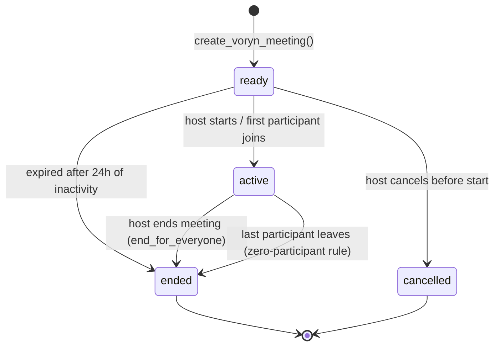
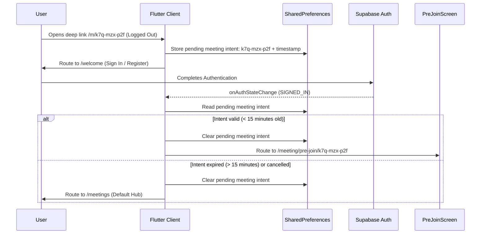
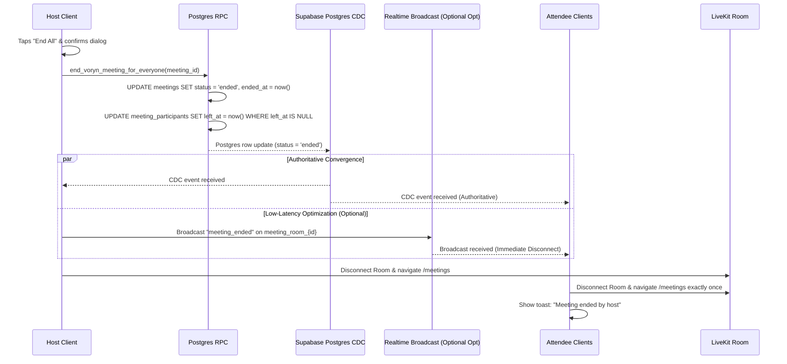

# VORYN — MEETINGS ARCHITECTURE SPECIFICATION (HARDENED)
**Checkpoint:** MEET-1R.1  
**Status:** Approved Hardened Architecture (Final Corrections)  
**Target Platforms:** Android + Web  

---

## 1. Executive Summary & Problem Scope

Voryn Meetings provides multi-party virtual conference rooms with join codes, shareable links, pre-join media validation, and host moderation boundaries. Unlike 1:1 direct calls and call-waiting merges (which transition between private telephone-like sessions), Meetings are identity-anchored rooms that must handle unauthenticated link arrival, media configuration before admission, variable participant departure, and host termination.

### Classification Taxonomy
Throughout this specification, all features, schemas, and components are categorized into three distinct statuses:
- **`[CURRENT]`**: Verifiably implemented in the database migrations or codebase today.
- **`[PROPOSED]`**: Approved product and technical design to be implemented in upcoming checkpoints (MEET-2A through MEET-3B).
- **`[DEFERRED / FUTURE]`**: Explicitly scoped out of current milestones to prevent over-engineering (Strict YAGNI).

---

## 2. Exact Database Schema Audit

### Current Database State `[CURRENT]`
The existing schema was created in `supabase/migrations/202609110003_complete_voryn_backend.sql` (lines 70–93, 128–143, 431–437).

#### `public.meetings`
```sql
create table if not exists public.meetings (
  id uuid primary key default gen_random_uuid(),
  host_uid uuid not null references auth.users(id) on delete cascade,
  title text not null check (char_length(title) between 1 and 60),
  join_code text not null unique,
  access text not null default 'link' check (access in ('link', 'invited')),
  status text not null default 'ready' check (status in ('ready', 'active', 'ended', 'cancelled')),
  scheduled_at timestamptz,
  started_at timestamptz,
  ended_at timestamptz,
  created_at timestamptz not null default now()
);
```

#### `public.meeting_participants`
```sql
create table if not exists public.meeting_participants (
  meeting_id uuid not null references public.meetings(id) on delete cascade,
  user_uid uuid not null references auth.users(id) on delete cascade,
  role text not null default 'participant' check (role in ('host', 'participant')),
  invited_at timestamptz,
  joined_at timestamptz,
  left_at timestamptz,
  primary key (meeting_id, user_uid)
);
```

### Table Column Status Matrix

| Table | Column Name | Type / Constraints | Status | Implementation Notes |
| :--- | :--- | :--- | :--- | :--- |
| `meetings` | `id` | `uuid primary key default gen_random_uuid()` | **`[CURRENT]`** | Verified in migration 202609110003. |
| `meetings` | `host_uid` | `uuid not null references auth.users(id)` | **`[CURRENT]`** | Verified. Foreign key cascades on user deletion. |
| `meetings` | `title` | `text not null check (length 1..60)` | **`[CURRENT]`** | Verified. Check constraint enforced in SQL. |
| `meetings` | `join_code` | `text not null unique` | **`[CURRENT]`** | Verified. Unique constraint and index exist. |
| `meetings` | `access` | `text check in ('link', 'invited')` | **`[CURRENT]`** | Verified. Default `'link'`. |
| `meetings` | `status` | `text check in ('ready', 'active', 'ended', 'cancelled')` | **`[CURRENT]`** | Verified. Default `'ready'`. |
| `meetings` | `scheduled_at` | `timestamptz` | **`[CURRENT]`** | Verified. Nullable column exists now. |
| `meetings` | `started_at` | `timestamptz` | **`[CURRENT]`** | Verified. Populated on meeting start. |
| `meetings` | `ended_at` | `timestamptz` | **`[CURRENT]`** | Verified. Populated on meeting end. |
| `meetings` | `created_at` | `timestamptz not null default now()` | **`[CURRENT]`** | Verified. |
| `meeting_participants` | `meeting_id` | `uuid references public.meetings(id)` | **`[CURRENT]`** | Verified. Cascades on meeting deletion. |
| `meeting_participants` | `user_uid` | `uuid references auth.users(id)` | **`[CURRENT]`** | Verified. Cascades on user deletion. |
| `meeting_participants` | `role` | `text check in ('host', 'participant')` | **`[CURRENT]`** | Verified. Default `'participant'`. |
| `meeting_participants` | `invited_at` | `timestamptz` | **`[CURRENT]`** | Verified. Populated on invitation. |
| `meeting_participants` | `joined_at` | `timestamptz` | **`[CURRENT]`** | Verified. Populated on entry. |
| `meeting_participants` | `left_at` | `timestamptz` | **`[CURRENT]`** | Verified. Nullable; null indicates active in room. |
| `meetings` | RLS direct select | Direct table permissions | **`[NEEDS MIGRATION]`** | `REVOKE ALL` was executed for `authenticated` in migration 202609110003. Direct queries and Realtime CDC fail unless SELECT is granted and RLS policy added. |
| `meeting_participants` | RLS direct select | Direct table permissions | **`[NEEDS MIGRATION]`** | Direct table access revoked. Needs SELECT grant and RLS policy for participant visibility. |
| `meetings` | `max_participants` | `int default 8` | **`[OPTIONAL/FUTURE]`** | Enforced at RPC level initially (YAGNI). Dedicated DB column deferred. |

---

## 3. Exact Existing RPC Contracts

### 1. `create_voryn_meeting` `[CURRENT]`
- **Signature:** `public.create_voryn_meeting(meeting_title text, meeting_access text default 'link')`
- **Security:** `language plpgsql security definer set search_path = ''`
- **Grants:** `REVOKE ALL from public; GRANT EXECUTE to authenticated;`
- **Auth Enforcement:** `if auth.uid() is null then raise exception 'Authentication required'; end if;`
- **Validation:** `char_length(trim(meeting_title)) between 1 and 60`, `meeting_access in ('link', 'invited')`.
- **Return Shape:** `table (id uuid, title text, join_code text, access text, status text, created_at timestamptz)`
- **Behavior:**
  1. Generates 9-char code in a `loop ... exit when not exists(...)` query.
  2. Inserts into `public.meetings` (`host_uid = auth.uid()`, `status = 'ready'`).
  3. Inserts into `public.meeting_participants` (`role = 'host'`, `joined_at = now()`).
  4. Returns the created meeting record.

### 2. `join_voryn_meeting` `[CURRENT]`
- **Signature:** `public.join_voryn_meeting(candidate_code text)`
- **Security:** `language plpgsql security definer set search_path = ''`
- **Grants:** `REVOKE ALL from public; GRANT EXECUTE to authenticated;`
- **Auth Enforcement:** `if auth.uid() is null then raise exception 'Authentication required'; end if;`
- **Validation:** Finds meeting matching `join_code = lower(trim(candidate_code))` and `status in ('ready', 'active')`. Returns empty result if not found.
- **Access Control:** If `meeting_row.access = 'invited'`, requires pre-existing record in `meeting_participants` for `auth.uid()`, else returns empty result.
- **Return Shape:** `table (id uuid, title text, join_code text, access text, status text, created_at timestamptz)`
- **Behavior:**
  1. Upserts into `public.meeting_participants` on conflict `(meeting_id, user_uid)` setting `joined_at = now(), left_at = null`.
  2. Returns the meeting row.
- **Critical Architectural Caveat:** Because `join_voryn_meeting` immediately mutates `meeting_participants`, it **cannot** be called during Pre-Join link resolution. Calling it on link arrival would falsely count users who close the preview as joined participants.

### 3. `list_my_meetings` `[CURRENT]`
- **Signature:** `public.list_my_meetings()`
- **Security:** `language sql stable security definer set search_path = ''`
- **Grants:** `REVOKE ALL from public; GRANT EXECUTE to authenticated;`
- **Auth Enforcement:** Filters `mine.user_uid = auth.uid()`.
- **Return Shape:** `table (id uuid, title text, join_code text, access text, status text, participant_count bigint, created_at timestamptz, started_at timestamptz, ended_at timestamptz)`
- **Behavior:** Returns past/active meetings joined by the authenticated user, ordered by `created_at desc`, limited to 100 rows.
- **Gaps Identified for MEET-2A:**
  - Does not return `mine.role` (user cannot distinguish hosted vs joined meetings).
  - Does not return `host_name` / `host_avatar_url`.
  - **Participant Count Disambiguation:** Currently counts participant rows ambiguously. MEET-2A must return both **Active Participant Count** (`joined_at IS NOT NULL AND left_at IS NULL`) for live status and **Historical Attendee Count** (`joined_at IS NOT NULL`) for meeting history, rather than a single overloaded count.

---

## 4. Canonical Meeting Lifecycle State Machine

The state machine strictly aligns with the existing database constraint `status in ('ready', 'active', 'ended', 'cancelled')`.



### Deterministic State Transitions

| Transition | From State | To State | Trigger / RPC | Permitted Caller | Invariants & Side Effects |
| :--- | :--- | :--- | :--- | :--- | :--- |
| **Create** | None | `ready` | `create_voryn_meeting()` | Authenticated Host | `started_at` is NULL; `ended_at` is NULL; join code generated. |
| **Start** | `ready` | `active` | `start_voryn_meeting()` `[PROPOSED]` | Host or Admitted Participant | `started_at = coalesce(started_at, now())`. LiveKit room admitted. |
| **Cancel** | `ready` | `cancelled` | `cancel_voryn_meeting()` `[PROPOSED]` | Host Only | Permitted only when `status = 'ready'`. Meeting link disabled immediately. |
| **Participant Join** | `active` | `active` | `join_voryn_meeting()` | Authenticated User | Upserts `meeting_participants` (`joined_at = now()`, `left_at = null`). |
| **Participant Leave**| `active` | `active` | `leave_voryn_meeting()` `[PROPOSED]` | Participant Self | Sets `left_at = now()`. If active count > 0, meeting remains `active`. |
| **Auto-End (Zero)** | `active` | `ended` | `leave_voryn_meeting()` `[PROPOSED]` | Triggered on Last Exit | Transactionally detects active count = 0. Sets `status = 'ended'`, `ended_at = now()`. |
| **End for Everyone** | `active` | `ended` | `end_voryn_meeting_for_everyone()` `[PROPOSED]` | Host Only | Sets `status = 'ended'`, `ended_at = now()`. Attendees converge authoritatively via Postgres CDC (`meetings.status = 'ended'`); optional Realtime Broadcast event is sent as a low-latency optimization. |

---

## 5. Zero-Participant Meeting Rule

### Decision: Option A — Transactional Auto-End `[PROPOSED]`
If the last active participant leaves an ongoing (`status = 'active'`) meeting, the meeting **automatically ends**.

#### Rationale:
- **No Background Daemon Required (Strict YAGNI):** Eliminates complex external cron pollers or unmetered background workers.
- **Eliminates Ghost / Zombie Rooms:** Prevents abandoned rooms from remaining open indefinitely in the database and LiveKit server.
- **Transactional Consistency:** Evaluated atomically inside Postgres during the `leave_voryn_meeting()` RPC execution.

#### Transactional Implementation Logic:
```sql
-- Inside leave_voryn_meeting(p_meeting_id):
update public.meeting_participants
set left_at = now()
where meeting_id = p_meeting_id and user_uid = auth.uid() and left_at is null;

-- Check remaining active participants in the same transaction:
select count(*) into remaining_active
from public.meeting_participants
where meeting_id = p_meeting_id and left_at is null;

if remaining_active = 0 then
  update public.meetings
  set status = 'ended', ended_at = now()
  where id = p_meeting_id and status = 'active';
end if;
```

*Exception:* If the meeting is still in `status = 'ready'` (e.g. host generated the link but has not entered the active room yet), it does NOT auto-end.

---

## 6. Host Departure Without Ending

### Decision: Meeting Continues `[PROPOSED]`
If the host leaves an active meeting by tapping **Leave** (instead of **End Meeting for Everyone**):

1. **Meeting Remains Active:** Participants continue communicating in the LiveKit room without interruption.
2. **Host Rejoin Allowed:** The host may rejoin the ongoing meeting at any point via the meeting link or code.
3. **Role Persistence:** The host's record in `meeting_participants` retains `role = 'host'`.
4. **End-for-Everyone Reserved:** The "End Meeting for Everyone" capability remains exclusively bound to the host upon rejoining. Non-hosts are never granted destructive room-wide teardown controls.
5. **Host Abandonment Safeguard:** If the host leaves and never returns, the meeting continues until the participants naturally conclude and exit. Once the final participant leaves, the **Zero-Participant Rule** automatically ends the meeting cleanly.
6. **Host Transfer:** Explicitly **`[DEFERRED]`** to future moderation milestones (Strict YAGNI).

---

## 7. Join Code Security & Entropy Reality

### Current Implementation Reality `[CURRENT]`
In `supabase/migrations/202609110003_complete_voryn_backend.sql` (lines 318–320):
```sql
loop
  new_code := lower(substr(encode(gen_random_bytes(8), 'hex'), 1, 3) || '-' ||
                    substr(encode(gen_random_bytes(8), 'hex'), 1, 3) || '-' ||
                    substr(encode(gen_random_bytes(8), 'hex'), 1, 3));
  exit when not exists (select 1 from public.meetings m where m.join_code = new_code);
end loop;
```

### Exact Entropy Audit
- **Alphabet Used:** Hexadecimal characters `[0-9a-f]` (lowercase). **NOT** base36 alphanumeric.
- **Character Count:** 9 hex digits formatted as `xxx-xxx-xxx` (11 characters including hyphens).
- **Total Combination Space:**
  $$16^9 = (2^4)^9 = 2^{36} = 68,719,476,736 \approx 6.87 \times 10^{10}$$
- **Entropy:** Exactly **36 bits of entropy**.
- **Cryptographic Randomness:** Relies on PostgreSQL's `gen_random_bytes(8)`, which interfaces directly with OpenSSL's CSPRNG. There is zero algorithmic bias or predictable seeding.
- **Collision Behavior:** Handled safely via transactional `loop ... exit when not exists(...)` query against the `join_code unique` index.

### Evaluation & MEET-2A Recommendation `[PROPOSED]`
While 68.7 billion combinations provides baseline collision resistance, expanding the alphabet for new meetings improves brute-force resistance:
- **Base36 Generator for New Codes:**
  - Alphabet: `0-9`, `a-z` (36 lowercase characters)
  - Length: 9 characters excluding hyphens (formatted as `xxx-xxx-xxx`)
  - Exact search space:
    $$36^9 = 101,559,956,668,416 \approx 1.0156 \times 10^{14} \text{ combinations}$$
  - Entropy: Exactly $\log_2(36^9) \approx 46.53\text{ bits of entropy}$.
  - **Cryptographic Randomness Mandate:** MEET-2A must use PostgreSQL cryptographic randomness (`gen_random_bytes(...)`), **NOT** `random()`. Cryptographic entropy is only achieved when derived from a CSPRNG; PRNG-based generation is strictly forbidden.

### Join Code Upgrade Compatibility
Existing meetings in the database may already contain 9-character hexadecimal codes `[0-9a-f]` formatted as `xxx-xxx-xxx`.
- **Existing Codes Remain 100% Valid:** All existing hexadecimal join codes remain active and functional.
- **RPC Resolution:** Both `join_voryn_meeting` and `resolve_meeting_for_prejoin` must continue resolving existing hex codes seamlessly without format discrimination.
- **No Mass Rewriting:** Existing `public.meetings.join_code` column values will **NOT** be rewritten or migrated.
- **New Code Scope:** The new base36 generator applies exclusively to newly created meetings.
- **Authoritative Uniqueness:** The PostgreSQL `UNIQUE` constraint on `public.meetings(join_code)` remains the single authoritative uniqueness safeguard across both legacy hex and new base36 codes.

### Rate Limiting Classification
- **MEET-2A Scope:**
  - Secure RPC authorization (`auth.uid() IS NOT NULL`).
  - Canonical join-code validation (trimming, case normalization, regex check).
  - Participant membership and product capacity enforcement.
  - Database authorization remains strictly secure even without rate-limiting infrastructure.
- **Future Backend Hardening Scope `[DEFERRED]`:**
  - Dedicated IP/account rate limiting.
  - Progressive abuse throttling and brute-force backoff.
  - Full rate-limiting infrastructure is omitted from MEET-2A to avoid premature dependencies (Strict YAGNI).

---

## 8. Canonical Meeting URL & Deep-Link Strategy

### Public Domain Configuration `[PROPOSED]`
The repository currently has **NO verified production Voryn web domain**. Therefore, production links must **NOT** default to `https://voryn.app`.

- **Configurable Base URL:** The public web origin must be configured per environment via `VORYN_PUBLIC_BASE_URL`:
  ```dart
  const vorynPublicBaseUrl = String.fromEnvironment('VORYN_PUBLIC_BASE_URL');
  ```
- **Canonical Web URL Format:**
  $$\text{URL} = \text{\${vorynPublicBaseUrl}/m/\{\text{joinCode}\}}$$
  *Example (when configured):* `https://example-meetings.com/m/k7q-mzx-p2f`
- **Development Fallbacks (Documented Separately):**
  - Flutter Web Local Dev: `http://localhost:3000/m/{joinCode}`
  - Android Emulator Dev: `http://10.0.2.2:3000/m/{joinCode}`
  - Physical Device LAN Dev: `http://<lan-ip>:3000/m/{joinCode}`
- **Production URL Invariant:** The client must **NEVER** generate or display a production-looking URL (such as `https://voryn.app`) when `VORYN_PUBLIC_BASE_URL` is unconfigured. In debug/local environments, it falls back to the explicit development host; in release environments, configuration is required before sharing web links.
- **Android Custom Scheme Status:**
  `voryn://meeting/{joinCode}` is strictly a **proposed fallback scheme**. It does **NOT** currently exist in `AndroidManifest.xml` or Flutter routing, and will not be claimed as existing until native intent-filters and routing are implemented in MEET-3A.
- **Security Invariant:** Deep-link URLs NEVER contain database UUIDs, authentication tokens, or user secrets.

---

## 9. Logged-Out Join Intent Preservation



### Protocol Invariants `[PROPOSED]`
1. **Storage:** Cached in `SharedPreferences` under key `_pending_meeting_join_code` with epoch timestamp `_pending_meeting_join_timestamp`.
2. **TTL:** 15 minutes maximum. If a user signs in hours or days later, the old intent is discarded.
3. **Consumption:** Cleared immediately upon successful navigation to the target pre-join screen.
4. **Cancellation:** If the user abandons login, the key naturally expires or is cleared on manual home navigation.
5. **Expired / Invalid Meeting Handling:** If the target meeting ended while the user was logging in, `resolve_meeting_for_prejoin` displays a graceful banner on `/meetings`: *"This meeting has already ended."*

---

## 10. Pre-Join Authorization & Privacy

### Decision: Authentication Mandatory `[PROPOSED]`
The `resolve_meeting_for_prejoin(candidate_code)` RPC **strictly requires Supabase authentication** (`auth.uid() IS NOT NULL`).

#### Privacy Rationale:
- A public, unauthenticated pre-join resolution endpoint would allow arbitrary internet scrapers to query random 9-character codes and harvest private user metadata (meeting titles, host full names, host avatar URLs, participant counts).
- In accordance with Voryn’s privacy-first architecture, unauthenticated visitors who click a link must log in or create an account *before* resolving meeting metadata.
- Once authenticated, the pre-join screen displays:
  - Meeting Title
  - Host Display Name & Initials
  - Current Active Participant Count
  - Local Camera Video Preview (mirrored)
  - Microphone Toggle & Camera Toggle
  - "Join Meeting" Action

---

## 11. Meeting Membership Model

### Decision: Model B — Explicit Join on User Action `[PROPOSED]`

```
┌────────────────────────────────────────────────────────┐
│ 1. Link Click / Code Entry                             │
│    -> Calls resolve_meeting_for_prejoin(code) [Read-Only]│
│    -> ZERO rows inserted into meeting_participants     │
└──────────────────────────┬─────────────────────────────┘
                           │
                           ▼
┌────────────────────────────────────────────────────────┐
│ 2. Pre-Join Screen Displayed                           │
│    -> Camera/Mic preview active locally                │
│    -> User can back out with NO ghost presence recorded│
└──────────────────────────┬─────────────────────────────┘
                           │ User taps "Join Meeting"
                           ▼
┌────────────────────────────────────────────────────────┐
│ 3. Explicit Admission                                  │
│    -> Calls join_voryn_meeting(code) [Transaction]     │
│    -> Upserts meeting_participants (joined_at = now)   │
│    -> Requests LiveKit token & enters GroupCallScreen  │
└────────────────────────────────────────────────────────┘
```

#### Why Model B is Mandatory:
- Calling `join_voryn_meeting` on initial link opening (Model A) falsely marks previewers as active participants (`joined_at = now(), left_at = null`), skewing participant counts if they close the browser tab.
- Pre-creating participant rows on link generation (Model C) is impossible for open public link meetings.
- Model B guarantees that `meeting_participants` records **only** users who committed to joining.

---

## 12. LiveKit Token TTL & Reconnection Strategy

### Proposed Initial Token TTL: 2 Hours `[PROPOSED]`
A 2-hour duration is defined as a **proposed initial meeting token TTL**, NOT as an established or mandatory LiveKit engine requirement.

| Parameter | 1:1 Direct Call | Multi-Party Meeting | Technical Justification |
| :--- | :--- | :--- | :--- |
| **Token TTL** | 10 Minutes | **2 Hours (Initial Proposal)** | Direct calls connect in seconds or fail. Meetings typically endure for 30–90 minutes. |
| **Reconnection Exposure** | Low | High | Mobile participants switch between Wi-Fi and 5G cellular. |
| **Token Refresh Support** | None | None | `livekit_client` in Flutter does not implement silent background token rotation without full room re-entry. |

#### Architectural Principles & Invariants:
1. **Server Issued:** Tokens are strictly minted and signed server-side by the `livekit-token` Supabase Edge Function; clients can never mint their own tokens.
2. **Room Scoped:** Every token is strictly scoped to a single meeting room (`meeting_room_{id}`).
3. **Pre-Issuance Membership & Status Verification:** Before generating a token, the Edge Function must verify:
   - Supabase user authentication (`auth.uid()`).
   - Meeting status is `'ready'` or `'active'` (`status != 'ended' AND status != 'cancelled'`).
   - User has an existing record in `public.meeting_participants` for that meeting.
4. **Configurable Server-Side:** The TTL duration is configurable via environment configuration (`MEETING_TOKEN_TTL_SECONDS`), defaulting initially to 7200 seconds (2 hours).
5. **Adjustable via Empirical Testing:** Later implementation and testing (MEET-2B / MEET-4) may adjust this TTL if actual client reconnection behavior, battery usage, or security policies require it.
6. **LiveKit Connection Lifetime:** In LiveKit WebRTC architecture, the JWT is validated during the initial WebSocket handshake. An active connection is not terminated when the JWT expires, but automatic client reconnections present the original JWT unless re-requested.

---

## 13. Participant Count Semantics & Capacity Limit

### Canonical Participant Count Definitions `[PROPOSED]`
To eliminate ambiguity between live meeting state and post-call analytics, the system strictly separates two distinct participant metrics:

1. **Active Participant Count:**
   - **SQL Predicate:** `meeting_participants WHERE meeting_id = m.id AND joined_at IS NOT NULL AND left_at IS NULL`
   - **Semantic Meaning:** Real-time count of users currently connected inside the active room.
   - **Used For:**
     - Room capacity limit validation (max 8 concurrent users).
     - Live conference header participant badge (`"3 participants"`).
     - Zero-participant auto-end evaluation in `leave_voryn_meeting`.

2. **Historical Attendee Count:**
   - **SQL Predicate:** `COUNT(DISTINCT user_uid) FROM meeting_participants WHERE meeting_id = m.id AND joined_at IS NOT NULL`
   - **Semantic Meaning:** Total count of unique registered users who joined the meeting at least once during its lifespan.
   - **Used For:**
     - Past meeting history records (`list_my_meetings`).
     - Post-meeting audit and detail views.

### Capacity Enforcement (Initial Milestone: 8 Participants) `[PROPOSED]`
- **Product Limit:** Maximum **8 concurrent active participants**.
- **Enforcement:** Enforced transactionally inside `join_voryn_meeting()` using the **Active Participant Count**:
  ```sql
  select count(*) into active_count
  from public.meeting_participants
  where meeting_id = m_row.id and joined_at is not null and left_at is null;

  if active_count >= 8 then
    raise exception 'Meeting is at maximum capacity (8 participants)';
  end if;
  ```
- **Architectural Rationale:**
  - Directly matches the validated, stress-tested responsive grid layouts in [`GroupCallScreen`](file:///d:/projects/voryn/lib/features/calling/group_call_screen.dart) (which provides optimized 2-split, 2x2, and 5-8 tile layouts).
  - Protects mobile battery and bandwidth on low-end Android hardware.
  - Can be increased in future milestones by updating a single configuration constant.

---

## 14. Screen-Sharing Policy

### Decision: Open Collaboration (First-Come, First-Served) `[PROPOSED]`
- **Policy:** Any admitted participant (host or attendee) may share their screen.
- **Concurrency:** Maximum **1 active screen share** at any time.
- **Behavior:** If a participant attempts to share while another screen share is active, the UI prompts: *"Someone else is already sharing their screen."*
- Host-only screen share locks and presenter delegations are **`[DEFERRED]`** to future moderation milestones.

---

## 15. In-Meeting "Add Participant" Semantics

### Decision: Link Sharing + In-App Invites (No Phone Calls) `[PROPOSED]`
Tapping **Add Participant** in an active meeting opens [`AddParticipantSheet`](file:///d:/projects/voryn/lib/features/calling/widgets/add_participant_sheet.dart):

1. **Share Meeting Link (Top Action):**
   - Prominently displays `{VORYN_PUBLIC_BASE_URL}/m/{joinCode}` (or configured local dev equivalent when unconfigured).
   - Provides one-tap **Copy Link** and native OS **Share** sheet triggers.
2. **In-App Direct Contact Invite:**
   - User searches and selects a saved Voryn contact.
   - **Crucial Rule:** Does **NOT** initiate an invasive phone-style ringing call.
   - Invokes backend RPC `invite_meeting_participant(meeting_id, target_user_id)`:
     - Inserts record into `meeting_participants` with `role = 'participant'`, `invited_at = now()`.
     - Sends a high-priority FCM notification / chat message: *"Vikash invited you to join: [Meeting Title]"* with an actionable **Join Meeting** button.

---

## 16. Meeting History Gaps & Alignment

### Current `list_my_meetings()` Output `[CURRENT]`
Returns: `id`, `title`, `join_code`, `access`, `status`, `participant_count`, `created_at`, `started_at`, `ended_at`.

### Identified Gaps to be Resolved in MEET-2A `[PROPOSED]`
1. **User Role Context (`is_host`):** Add `mine.role = 'host' as is_host` so the client UI can display `"Hosted"` vs `"Joined"` badges.
2. **Disambiguated Participant Counts:** Separate the ambiguous single `participant_count` into:
   - `active_participant_count`: `COUNT(mp.user_uid) FILTER (WHERE mp.joined_at IS NOT NULL AND mp.left_at IS NULL)` (for live meetings).
   - `historical_attendee_count`: `COUNT(DISTINCT mp.user_uid) FILTER (WHERE mp.joined_at IS NOT NULL)` (for meeting history).
3. **Host Profile Details:** Join `public.profiles` on `m.host_uid` to return `host_name` and `host_avatar_url`.
4. **Calculated Duration:** Add computed duration in seconds (`extract(epoch from (coalesce(m.ended_at, now()) - m.started_at))::int`).

---

## 17. End-for-Everyone Teardown Convergence

### Authoritative State Source `[PROPOSED]`
The **single authoritative source of truth** for meeting termination is the database record:
$$\text{public.meetings.status} = \text{'ended'}$$
Clients observe this status transition primarily through **Supabase Postgres CDC** (Change Data Capture on `public.meetings`).

> [!IMPORTANT]
> A PostgreSQL row update does **NOT** automatically generate a Supabase Realtime Broadcast message. Broadcast messages require an explicit publish call. If an explicit Realtime Broadcast event (`meeting_ended`) is dispatched, it acts strictly as a **low-latency optimization**, NOT the authoritative state mechanism. If any client drops or misses the broadcast, Postgres CDC and server-side RPC guards ensure authoritative convergence.

### Protocol Sequence `[PROPOSED]`



#### Convergence Invariants:
1. **Database as Single Source of Truth:** The database row (`meetings.status = 'ended'`) is authoritative. Even if a client misses the Realtime broadcast due to a temporary Wi-Fi blip, the Postgres CDC stream or next poll/token check observes `status = 'ended'` and disconnects immediately.
2. **Broadcast as Optional Accelerator:** Broadcast delivery is non-authoritative; failure to receive a broadcast never prevents clean teardown.
3. **Single Navigation Guarantee:** Disconnect and route pop are guarded by `_ended = true` to prevent double-pop exceptions.

---

## 18. Updated Phased Implementation Roadmap

| Checkpoint | Scope & Description | Status |
| :--- | :--- | :--- |
| **MEET-1R.1** | Architecture corrections: Configurable Public URL, custom scheme status, Postgres CDC end convergence, join code compatibility, base36 CSPRNG math, rate limiting scope, token TTL classification, active/historical participant count definitions. | **COMPLETE** |
| **MEET-2A** | Database migration: Add `resolve_meeting_for_prejoin`, `start_voryn_meeting`, `leave_voryn_meeting`, `end_voryn_meeting_for_everyone`, `invite_meeting_participant`, updated `list_my_meetings`, and SELECT grants. | **NEXT** |
| **MEET-2B** | Edge Function hardening: Extend `livekit-token` with `meetingId` authorization, participant membership validation, and 2h token issuance. | **PLANNED** |
| **MEET-2C** | Flutter Calling Service: Implement `VorynMeetingService`, Dart models (`VorynMeeting`, `VorynMeetingParticipant`), and `VorynLiveKitService.connectMeeting()`. | **PLANNED** |
| **MEET-3A** | Pre-Join Screen & Deep Linking: Implement camera/mic staging preview, GoRouter `/meeting/:code`, intent caching, and Android App Links. | **PLANNED** |
| **MEET-3B** | Meetings Tab & Conference Wireup: Replace mock UI in `MeetingsScreen` with live Supabase data; connect `GroupCallScreen` as active meeting room. | **PLANNED** |
| **MEET-4** | End-to-End Verification: Unit, widget, and responsive tests across mobile and web. | **PLANNED** |
| **FUTURE** | Host role transfer, waiting rooms/lobby, remote mute/kick, and cloud recording. | **DEFERRED** |
