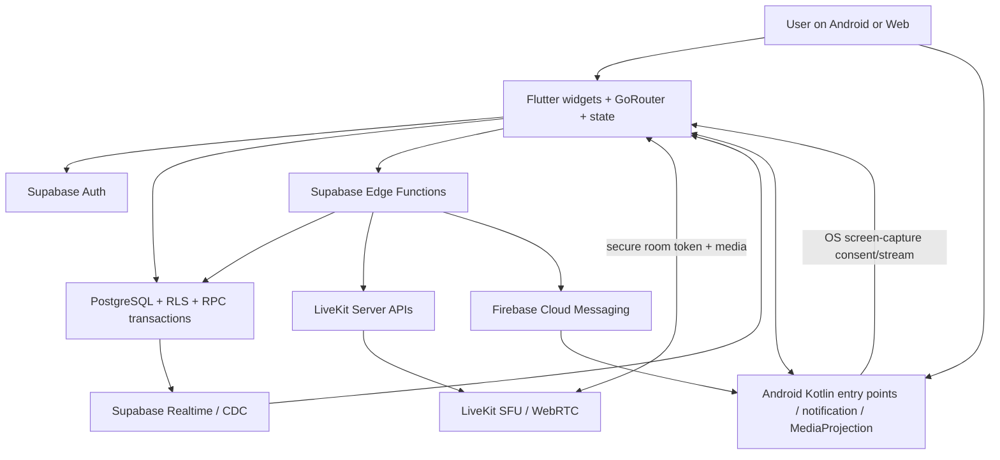
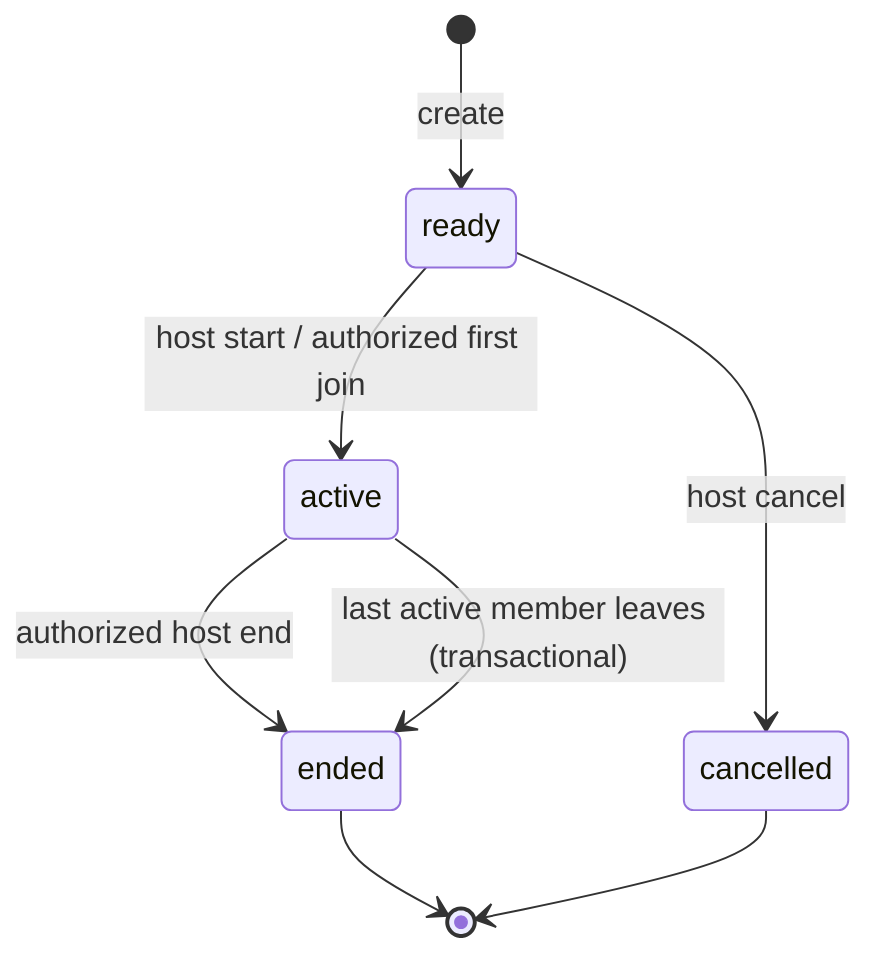
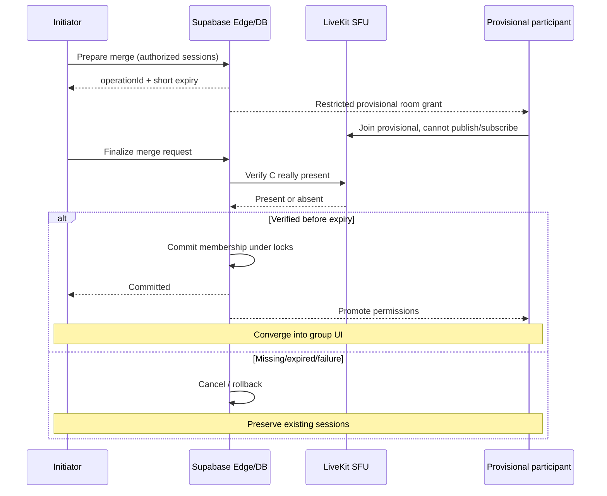
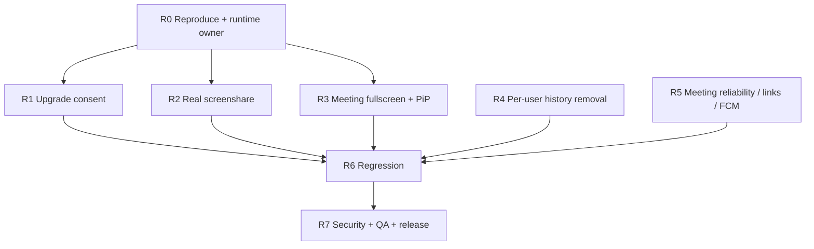

# VoRyn — Master Project Context, Product Specification, Technical Architecture & Delivery Plan

> **Document version:** 2.0 — consolidated living master context  
> **Snapshot date:** **13 October 2026**  
> **Project:** **VoRyn** — real-time calling, communication, and meetings  
> **Primary clients:** Flutter **Android** and **Web**; iOS is a future option, **not a verified delivered platform**  
> **Primary coding agent:** Antigravity; Codex when its quota is exhausted  
> **Document destination:** `docs/VORYN_MASTER_PROJECT_CONTEXT.md` in the repository  
> **Current phase:** Runtime stabilization, media reliability, end-to-end verification, and completion of user-history management  
> **Important:** This is a *product/project knowledge base*, not a guarantee that the current checkout implements everything written here.

---

## 0. READ THIS FIRST — HOW TO INTERPRET THE DOCUMENT

This document answers **what VoRyn is**, **what we have built**, **which technologies we use**, **how frontend/backend/database/media interact**, **which problems are still present**, **what will be implemented next**, **how to implement it safely**, and **exactly how a finished version should behave**.

### Evidence labels used throughout

| Label | Meaning |
|---|---|
| **REQUIREMENT** | Desired product behavior approved or requested by the user; not necessarily implemented. |
| **REPORTED IMPLEMENTED** | An Antigravity completion report describes the code as implemented. |
| **AUTOMATED VERIFIED (REPORTED)** | A report lists successful unit, widget, SQL, static-analysis, or build checks; the underlying device behavior may still fail. |
| **REMOTE VERIFIED (REPORTED)** | A report describes a deployed Supabase migration/Edge Function or database-side check. |
| **RUNTIME FAILED / OPEN** | The user observed real behavior that is still broken or unconfirmed despite earlier reports. |
| **PENDING / UNVERIFIED** | No trustworthy evidence of completion was supplied; must not be represented as working. |
| **DESIGN PROPOSAL** | Recommended implementation, not proof of existing database schema or source code. |

**Order of truth when sources conflict:** fresh real-device evidence and current checked-in code/runtime behavior; latest explicit product decision; current deployed database/function definitions; repository development rules; recent checkpoint reports; old PRD/TRD and brainstorming; mockups. Old documents under `voryn_project_docs/` and `voryn_agent_memory/` may contain superseded branding, keyboard, or schema proposals. Validate against the current repository before executing.

**Never turn a mock, screenshot design, `flutter test` result, or completed `flutter build` into a claim of successful real audio/video, device PiP, screen sharing, push delivery, or authenticated backend behavior.**

### Executive answer: where are we now?

**As of 13 October 2026**, substantial parts of VoRyn exist in code and repeatedly pass automated suites. Auth/profile, contact discovery, call/meeting UI, Supabase/LiveKit infrastructure, Call Messages, call waiting/merge, meetings, links, invitations, and push are all **reported implemented to varying degrees**. The project is **not yet release-ready** because actual-device testing has repeatedly identified media/UX issues and several requirements remain pending.

**Currently open user-reported defects / next stabilization scope:**

1. **P0 — Direct video-call screen sharing fails**: prove Android MediaProjection capture, foreground service where required, actual LiveKit publication, remote subscription, and visible shared content. Meeting sharing must also be verified; earlier reports did not prove it.
2. **P0 — Audio→video upgrade consent is routed incorrectly**: the requester **also** sees Accept/Decline. Only the *other participant* should be prompted; the requester must see Waiting, and a single valid acceptance must transition both endpoints without a second request.
3. **P1 — Active meetings not truly fullscreen**: main four-tab bottom navigation and other app-shell elements remain visible. Active meeting media must render **outside the main tab shell**, with tap-to-hide controls and tap-to-restore.
4. **P1 — In-call local self-video PiP remains non-draggable on the tested device**, despite successive reported fixes. Diagnose actual native vs Flutter renderer and gesture/hit-testing with device evidence.
5. **P2 — Users need to remove personal call history and past-meeting history** without deleting shared canonical call/meeting records, without changing other users' history, and without ending live meetings. This feature was **requested but no completion report has yet verified implementation**.
6. **Release blockers:** real two-device Android media verification, device notification tests, reliable room cleanup on last participant exit, real public HTTPS domain/App Link configuration, fresh database migration replay, and full end-to-end regression testing.

**Latest issued work prompt** was `VORYN-RUNTIME-FIX-3` for direct screen sharing, recipient-only video-upgrade prompts, meeting fullscreen routing, and per-user history removal. **No completed implementation report for that prompt has been provided in this conversation.** Do not mark it finished.

---

## 1. PRODUCT VISION, POSITIONING, AND SUCCESS

### 1.1 What is VoRyn?

VoRyn is a unified real-time communication application offering:

- secure account identity and exact-person discovery;
- one-to-one **audio** and **video** calls;
- **consensual audio-to-video upgrades** mid-call;
- live **screen sharing** inside eligible calls and meetings;
- call waiting, hold, switch between calls, and merge calls;
- an address book combining saved VoRyn contacts with permitted phone contacts;
- **Call Messages**, a lightweight call-centric messaging inbox (not a full general-purpose social chat service);
- recent calls and call details;
- link-based and invited-only **group meetings** with a participant roster, host controls, and meeting history;
- Android background/incoming-call and invitation notifications;
- the same visual identity and trusted backend across Android and Web.

The product should feel like a focused, familiar combination of a modern calling app and a meeting application, **without copying another app's branding, fake marketing claims, or unnecessary complexity**.

### 1.2 Core user promise

> Find the right person, connect immediately when permitted, communicate by voice/video or a short message, and bring others into a meeting—without sacrificing privacy, reliability, or control over the camera and microphone.

### 1.3 Definition of a successful finished product

At completion, two or more **real accounts on distinct devices** can register, discover permitted identities, exchange short messages, start and receive calls, upgrade an audio call to video with one recipient approval, hold/switch/merge calls, share screens, create/join meetings, manage invitations, exit cleanly, and manage personal history. Backend authorization must withstand hostile clients; failures and reconnects must converge to honest UI; Android device behavior must be demonstrated, not inferred.

### 1.4 Scope boundaries and non-goals

- **Email:** required account contact/identifier in the requirements, **not an address for placing calls**.
- **Unknown-person search:** exact VoRyn ID or exact normalized phone; no unrestricted global fuzzy directory.
- **Messages:** short call-focused text and quick replies; no read receipts, voice notes, reactions, giant chat system, or fifth main tab unless the product requirements explicitly change.
- **Payments / subscriptions / CRM:** not part of this VoRyn project.
- **Meeting invitation notification:** not a phone call; no intrusive call-like ringing UI.
- **iOS:** may be planned later but do not claim parity with Android/Web.
- **Scheduling:** old database supports `scheduled_at`; full scheduling/calendar UI is **not confirmed implemented**.

---

## 2. PRODUCT DECISIONS AND TERMINOLOGY

| Area | Current decision / expectation |
|---|---|
| Visible app name | **VoRyn** (latest user-approved display capitalization, including launcher). Older PRD/AI_RULES says `Voryn`; **superseded for user-facing branding**. Do not rename internal package IDs/schema keys casually. |
| Navigation | Exactly **Connect · Recents · Contacts · Meetings**. Global Call Messages and profile entries, no fifth tab. |
| Brand palette | Emerald green with white in light mode; **neutral charcoal/near-black dark backgrounds**, green used mainly as accent; no gold. |
| Current icon preference | Latest user choice: **green rounded-square phone handset with white outgoing calling waves**, no exterior white border/black corners. Confirm actual asset installed in launcher/Web. Earlier chat-bubble variants were superseded. |
| Search | Exact VoRyn ID or exact phone; backend lookup only on **Search**. Cached/local filtering while typing. |
| Identity | Stable Supabase Auth UUID internally; mutable VoRyn ID/phone for discovery. Email hidden from discovery and call addressing. |
| Availability | Auto Online/Offline from reachability; Busy from call state; DND manual/persistent; DND blocks calls but permits messages. |
| Video upgrade | Requester: waiting/cancel; recipient only: Accept/Decline; one acceptance changes same existing call, subject to camera consent. |
| Direct call full-screen | No app-shell bottom navbar in active call. Tap media to hide/show call overlays. Draggable local preview plus optional 50/50 split. |
| Meeting full-screen | No app-shell navbar while in active room; immersive media controls hide/show on tap. |
| Meeting codes | New 9-character base36 formatted `xxx-xxx-xxx`; legacy 9-hex-digit `xxx-xxx-xxx` supported. |
| Meeting access | `link` or `invited`; invited-only requires registered invitation, link alone never overrides authorization. |
| Meeting capacity | Eight simultaneous active participants in existing meeting contract; invitations do not reserve seats. |
| Meeting lifecycle | `ready → active → ended`; `ready → cancelled`; ended/cancelled terminal. |
| History deletion | **Remove from My History**, using per-user visibility, not destructive shared-row deletion. **Pending implementation**. |
| Physical QA | Full end-to-end multi-device matrix at the end, but **known currently failing device behaviors must be investigated immediately**, not deferred as “passed”. |

### 2.1 Decisions that require checking against current code

1. **Connect input UI:** early sketches requested a custom Gboard-like QWERTY keyboard with a number row. A later PRD prefers **native text input** with VoRyn ID/Phone selection. Preserve whichever currently approved implementation exists; decide explicitly during a focused UX review rather than silently swapping it.
2. **Initial login methods:** email/password exists in reports; Google OAuth was previously observed freezing on Web. Do not report every provider as production-ready.
3. **Profile disclosure nuances:** exact-ID lookup must not reveal phone/email; exact-phone lookup may establish proof of that matched number. Details must be enforced by backend privacy rules.
4. **Meetings public URL:** no verified production HTTPS domain or Digital Asset Links file has been supplied. A configurable template is not an operational external link.
5. **History deletion policy:** user has requested removing history; product must confirm whether optional Undo and Clear All are desired. Default to per-user removal with explicit confirmation.

---

## 3. PERSONAS, USER ROLES, AND AUTHORIZATION

**Registered user:** owns identity, preferences, contacts, messages, call history, membership, and personal history visibility. Can call permitted users and join public-link meetings when eligible.

**Caller/requester:** initiates a call or upgrade; can cancel pending request but **cannot accept on recipient's behalf**.

**Receiver:** chooses Accept/Decline for calls/video upgrades; decides local camera/microphone permissions and device publishing.

**Meeting host:** creates and owns meeting; can end for everyone/cancel eligible meetings. Host role must survive reconnect, leaving/rejoining, and UI rebuilds; no silent transfer is part of current contract.

**Meeting participant:** may join when authorized, leave personally, and invite contacts if current RPC permits. An invited-but-unjoined row is **not** an active participant and cannot receive a LiveKit meeting token.

**Blocked user / DND target:** calls or messages are restricted by applicable backend policies. Neither Flutter hiding a button nor knowing a private UUID is permission.

**Server/Edge service identity:** can perform privileged signing, FCM dispatch, and LiveKit room administration only after verifying end-user identity and resource authorization. Service credentials never appear in Flutter.

---

## 4. USER EXPERIENCE, INFORMATION ARCHITECTURE, AND SCREENS

### 4.1 App shell

Normal authenticated shell: top-level `Connect`, `Recents`, `Contacts`, `Meetings`. A **single** profile avatar accessible on every main tab; a global Call Messages entry without introducing a fifth tab. Preserve state when switching tabs when appropriate.

**Important routing rule:** incoming ringing screens, active audio/video calls, and active meeting-room screens are **immersive destinations outside the shell**. Normal bottom navigation must not appear on those routes. An authenticated meeting details/pre-join page may still use ordinary navigation according to current UX; once active meeting starts, shell bars disappear.

### 4.2 Authentication and onboarding

- Welcome / email login / supported OAuth; account creation with unique VoRyn ID, phone number and email (mandatory under frozen v2); optional profile display name/avatar where appropriate.
- Validate uniqueness and normalized phone; never claim an available ID based only on local checks.
- Profile: view, edit, share profile/QR if implemented, Settings, Help, Log Out, Delete Account. Delete Account requires serious confirmation and backend/local cleanup.
- Settings: Appearance Light/Dark/System; DND; privacy who-can-call-me; notifications, blocked users, device sessions, help/report as appropriate.
- Android permission requests should occur at relevant moments with explanations; no unnecessary upfront permission wall.

### 4.3 Connect

- Segmented VoRyn ID / Phone search (as in later PRD); exact match via explicit action.
- Search results: safe name/avatar/VoRyn identity; Audio / Video / Message / Save / Block / Report as authorized.
- Unknown-person search never reveals unshared phone/email or entire directory.
- Pre-call choice between audio and video, clear presence/busy/offline outcome; no fake ringing if known unreachable.

### 4.4 Recents and call details

- Real backend call history, chronological ordering, Today/Yesterday/Earlier grouping, incoming/outgoing/missed, audio/video, duration, timestamps, avatar/name fallback, search/filter, pull-to-refresh, pagination where supported.
- Details: Audio, Video, Message; avoid redundant generic Connect button.
- **New**: per-entry Remove from My History and optional Clear History; menu/long-press → confirmation → authenticated server change → list refresh. Never erase shared call lifecycle or other participant's history.
- Honest loading/empty/error/retry states; no mock production records.

### 4.5 Contacts

- Saved custom names, VoRyn ID and authorized phone link; import phonebook after permission; dedupe imported and VoRyn records; later auto-link registered users by verified phone where allowed.
- Name priority: device phonebook name → private saved VoRyn name → canonical profile name.
- Do not store sensitive identifiers redundantly or show private email/phone merely because the user was discovered by VoRyn ID.
- Search/filter locally while typing; exact remote lookup only on Search.

### 4.6 Call Messages

- Lightweight inbox, quick reply from incoming call, message while connected, action in Recents → Call Details.
- Short message text (historical PRD target approximately **120 characters**; check current enforced limit), templates/presets, send/store/deliver even when receiver temporarily offline.
- Separate sending/status states; durable storage plus outbox/retry; no invented read receipts.
- Message notifications are **not** meeting invitations or full-screen incoming calls.

### 4.7 One-to-one audio call

Show remote identity, real call state, timer when connected, mute, audio route/speaker, hold, add participant, message, End; Video button requests a **consensual upgrade**, not unilateral publishing. Preserve existing audio route and call session while negotiating.

### 4.8 One-to-one video call

Remote video fills stage; local video appears as a draggable in-call PiP. Controls: mute, camera on/off, flip, audio, share, end; contextual message as secondary. Support camera-off fallback, 50/50 split view (portrait vertical, landscape side-by-side), controls hidden on tap and restored on tap. No stale `Calling…` badge once genuinely connected. PiP must move on the **actual device renderer**, not merely in widget tests.

### 4.9 Incoming call and lock-screen safety

Dedicated native ringing presentation with caller name, audio/video type, Accept, Decline, Message/Remind as approved. A locked device **must not flash the main app shell**. Decline dismisses the incoming UI and leaves the device locked; Accept goes directly to active call context. Background push and Android notifications obey the OS, user permissions, and foreground rules.

### 4.10 Call waiting / concurrent calls / merging

- Call Waiting offers Hold & Accept, Decline, Message when appropriate; DND overrides call waiting.
- Hold and switch maintain distinct call identities/media session ownership; don't route actions to the wrong call.
- Merge uses restricted provisional LiveKit join, trusted SFU verification, then commit; rejoin/recovery and expiration rollback.
- Group conference includes real participants, count, controls, appropriate leave-self vs end-all permissions, screen sharing, add participant.

### 4.11 Meetings

Meetings tab: New Meeting, Join by Code, Hosted/Joined/Invited states, upcoming/active/past records, real timestamps and attendee counts. Create a titled `link` or `invited` meeting; show shareable code and configured link. Link/code opening performs *read-only* pre-join resolution. Join only on explicit tap. Active meeting view includes grid/speaker view, screen share, participants, invited contacts, share code/link, Leave, host-only End Everyone.

**Required UX:** active meeting starts on a full-screen route **without app bottom navbar**; a tap on unused video toggles meeting overlay controls; local preview floats where appropriate. Shared-screen video takes the main stage, participants remain accessible, camera/microphone and timer do not reset when layouts change.

### 4.12 Meeting details/history

Show real title, code, access, host, status, participant roster and counts, valid duration, invited status, personal past meetings. Provide **Remove from My History** for historical records only, rather than deleting the meeting shared by everyone. Do not use Remove History to cancel upcoming/active meetings or end ongoing media.

---

## 5. TECHNOLOGY STACK — WHAT EACH COMPONENT DOES

| Layer | Current technology | Primary responsibility | Validation notes |
|---|---|---|---|
| UI framework | **Flutter + Dart** | Shared widgets/screens/state for Android and Web | Actual UI route differs between Flutter and some native Android call entry paths; inspect before fixing runtime bugs. |
| Navigation | **GoRouter** | Tab shell, authentication redirects, meeting routes `/m/:code`, active session destinations | **Main shell must not wrap active calls/meetings.** |
| Themes | Flutter Material theme + `VorynColors`, theme controller | Emerald/white and neutral charcoal; Light/Dark/System | Appearance was reported migrated; actual launcher icon and dark visuals need spot checks. |
| Android | **Kotlin**, Android Activities, MethodChannel, notification managers | Lock-screen call UI, FCM routing, deep-link handling, OS media projection, foreground services | MediaProjection/native rendering is an active failure-investigation area. |
| Web | **Flutter Web**, PWA/web manifest | Responsive browser UI and incoming meeting-link routes | Web builds passed; hosting/public domain rewrite not verified. |
| Auth | **Supabase Auth** | User identities, sessions/JWT verification | Do not confuse with Firebase Authentication. Google OAuth on Web has a historical freeze issue. |
| Database | **Supabase PostgreSQL** | Profiles, contacts, calls, memberships, messages, devices, meetings, history visibility | Remote schema is authoritative; avoid assuming older design docs match deployed DB. |
| Security | **RLS, authenticated RPCs, SECURITY DEFINER with fixed search_path** | Identity-scoped data access and atomic lifecycle transitions | Confirm actual grants/policies; protect against authorization bypass in Edge Functions. |
| Server logic | **Supabase Edge Functions (Deno/TypeScript)** | LiveKit token signing, merge verification, end-room API, meeting invitation push | Server secrets only. Deploy/test function changes separately. |
| Event synchronization | **Supabase Realtime / PostgreSQL CDC**, plus controlled reconciliation | Call/meeting state and participant changes; optional signaling | Realtime delivery can be missed; use authoritative refresh where needed. |
| Audio/video/SFU | **LiveKit / WebRTC** | One LiveKit Room/session per active call or meeting, audio/video/data/screen tracks | Connection and publication are distinct; real media verification pending. |
| Notifications | **Firebase Cloud Messaging HTTP v1**, Android channels | Incoming calls, Call Messages, meeting invites; background/terminated behavior | Push is best-effort, not source of truth or permission grant. |
| Media projection | **Android MediaProjection** and corresponding LiveKit capture methods; browser capture API when available | Screen capture and publication | **Currently broken in tested direct video calls.** |
| Local efficiency | In-memory/persistent cache where appropriate | Faster contacts, Recents, messages, permitted profile data | Do not cache private identity fields without permission; invalidate on logout/switch. |
| Testing | Flutter unit/widget/integration tests, SQL fixtures, Edge security tests, emulator/physical QA | Code correctness and runtime evidence | Mock tests do not prove two-device calls; observed regressions override report labels. |
| Version control | **Git / GitHub** | Reviewable checkpoint commits, clean branch history, rollback | Repo has accumulated uncommitted changes in some reports; audit first. |
| Development agents | **Antigravity** first; **Codex** fallback | Implement one scoped checkpoint; generate reports | Use only one coding agent at a time. |

### 5.1 What is *not* part of the stack

- Firebase is **not** the main database or identity provider; FCM is the notification layer.
- LiveKit is **not** the authority for membership/history/privacy; PostgreSQL and backend authorization are.
- FCM and LiveKit data messages are **not** authoritative permission grants; server-validated state controls access.
- A successful token response is **not** proof of a connected media room.
- A database status of `ended` does **not** automatically remove already-connected WebRTC peers without LiveKit server cleanup.

### 5.2 Supabase environment

A linked Supabase project reference was repeatedly shown in reports: `nrkaqtrsrfozqyzqbwth`. **This is project context, not a secret credential.** Verify the actual linked project and environment before any deployment. Never copy project access tokens or service-role keys into documentation.

---

## 6. LAYERED SYSTEM ARCHITECTURE



### 6.1 Frontend responsibilities

- Own navigation, accessibility, permission prompts, local media intentions and honest UI state.
- Request only authorized RPC/Edge operations using current authenticated session.
- Subscribe to call/meeting state for a **specific** call or meeting ID; clean up subscriptions correctly.
- Preserve camera/mic preferences across navigation and reconnect.
- Avoid constructing a second LiveKit room when toggling audio/video, screen sharing, layouts, or PiP.
- Never claim Connected until actual LiveKit state and backend session state agree sufficiently.
- Never embed privileged secrets, directly manipulate protected membership tables, or decide host rights from client booleans alone.

### 6.2 Database responsibilities

- Persist authoritative profiles, relationships, call/meeting state, message history, and invitation memberships.
- Authorize using `auth.uid()` and RLS; sensitive transitions should be encapsulated in transaction-safe RPCs.
- Enforce call/meeting lifecycle terminality, capacity, role, duplicate/unique constraints and idempotency.
- Record events for reconciliation and authorized history without leaking other users' rows.
- Treat per-user **history hiding** as separate from deleting shared call/meeting lifecycle records.

### 6.3 Edge Function responsibilities

- Validate verified bearer identities, not `uid` supplied in request JSON.
- Read server-authoritative resource state; use least privilege.
- Issue LiveKit tokens with room-scoped permission, minimal TTL and proper identity.
- Verify SFU presence before merge commit; delete room only after properly authorized meeting end.
- Send targeted FCM to tokens looked up on the backend after a successful authorized invitation.
- Use structured error semantics for partial failures; never return false success if only DB or only LiveKit work succeeded.

### 6.4 LiveKit responsibilities

- Transport microphone, camera, screen-share, subscribed remote tracks and (where useful) ephemeral data channel events.
- Distinguish `Room.connected`, track published, participant subscribed and UI rendered.
- One session owner controls track lifecycle; all teardown callers share one idempotent teardown operation.
- Rebuilds must not reconstruct the engine, dispose tracks twice, or unpublish stale publication references.

### 6.5 Android responsibilities

- Foreground/background/terminated FCM handling and OS notification channels.
- Secure, lock-screen-safe incoming-call UX, separated from normal MainActivity tab shell.
- Deep-link intent and account handoff without duplicate route actions.
- MediaProjection consent/required foreground-service and valid Android SDK permission behavior.
- Actual touch gesture hit-testing for local preview if native Activity or platform view owns the surface.

### 6.6 Suggested domain/module dependency rule

**Presentation → typed service/coordinator → authenticated backend/API → authoritative persistence → Realtime/reconciliation → UI.** Keep media ownership in session/controller layers, not in arbitrary widgets. Allow local layout changes without backend or LiveKit reconnect. Split transport failure handling from persistent state transitions.

---

## 7. REPRESENTATIVE REPOSITORY MAP

> Paths were observed in past Antigravity reports or associated documents. **They are illustrative, not a current filesystem inventory.** Check the checkout before edits.

```text
voryn/
├── pubspec.yaml
├── lib/
│   ├── main.dart                       # app boot, router, auth handoff
│   ├── core/
│   │   ├── theme/
│   │   │   ├── voryn_colors.dart       # semantic design tokens
│   │   │   ├── voryn_theme.dart
│   │   │   └── voryn_theme_controller.dart
│   │   └── notifications/
│   │       └── voryn_firebase_messaging.dart
│   ├── features/
│   │   ├── auth/
│   │   │   └── auth_screens.dart
│   │   ├── contacts/
│   │   │   ├── voryn_contact_service.dart
│   │   │   └── contacts_live_screen.dart
│   │   ├── calling/
│   │   │   ├── active_audio_call_screen.dart
│   │   │   ├── active_video_call_screen.dart
│   │   │   ├── incoming_call_screen.dart
│   │   │   ├── group_call_screen.dart
│   │   │   ├── voryn_call_service.dart
│   │   │   ├── voryn_livekit_service.dart
│   │   │   ├── voryn_call_history_service.dart
│   │   │   ├── voryn_call_runtime_coordinator.dart
│   │   │   ├── multi_call_coordinator.dart
│   │   │   ├── video_upgrade_models.dart
│   │   │   └── widgets/
│   │   │       ├── video_pip.dart
│   │   │       ├── call_top_bar.dart
│   │   │       ├── call_controls.dart
│   │   │       └── screen_share_banner.dart
│   │   ├── recents/
│   │   │   └── recents_screen.dart
│   │   └── meetings/
│   │       ├── meetings_screen.dart
│   │       ├── meeting_room_screen.dart
│   │       ├── meeting_direct_link_screen.dart
│   │       ├── models/meeting_models.dart
│   │       ├── services/
│   │       │   ├── voryn_meeting_service.dart
│   │       │   └── voryn_meeting_link_service.dart
│   │       └── widgets/meeting_invite_sheet.dart
│   └── shared/widgets/
├── android/app/src/main/
│   ├── AndroidManifest.xml
│   └── kotlin/com/voryn/app/
│       ├── MainActivity.kt
│       ├── VorynFirebaseMessagingService.kt
│       ├── VorynMeetingNotificationManager.kt
│       └── [native call activities/notification classes]
├── web/
│   ├── index.html
│   ├── manifest.json
│   └── icons/
├── assets/branding/                   # verify actual logo source
├── supabase/
│   ├── migrations/
│   ├── functions/
│   │   ├── livekit-token/
│   │   ├── finalize-call-merge/
│   │   ├── cancel-call-merge/
│   │   ├── end-voryn-meeting/
│   │   └── send-meeting-invitation/
│   └── tests/
├── test/
│   ├── meet_3a_meetings_test.dart
│   ├── meet_4b_invitations_test.dart
│   ├── meet_4c_notifications_test.dart
│   ├── meet_creation_fix_test.dart
│   ├── meet_join_fix_test.dart
│   ├── call_av_1_upgrade_test.dart
│   ├── call_upgrade_handshake_fix_test.dart
│   ├── video_ux_fix_test.dart
│   └── recents_history_fix_test.dart
└── docs/
    └── VORYN_MASTER_PROJECT_CONTEXT.md
```

**Repository may contain other files and names.** Do not assume paths that have not been confirmed; use scoped `git grep` / file inspection.

---

## 8. DATABASE ENTITIES, STATE, SECURITY, AND MIGRATIONS

### 8.1 Identity and contacts — design/schema concepts

| Entity | Purpose | Important rule |
|---|---|---|
| `auth.users` | Supabase-managed account identity | Never query it arbitrarily from a client. |
| `public.profiles` | Public-safe profile/VoRyn ID/name/avatar/private identity fields | Do not expose full profile row to unknown users. |
| `user_settings` | DND, privacy, appearance, related preferences | Owner-scoped; actual columns may differ. |
| `user_presence` / Realtime Presence | Automatic Online/Offline/Busy | Reachability; do not expose fabricated online state. |
| `user_devices` | Device registration/FCM tokens | Owner-scoped writes; FCM token resolution backend only. |
| `voryn_contacts` | Private saved contacts and matched user links | Stable UUID, avoid duplicates. |
| `user_blocks`, `user_reports` | Blocking and abuse reports | Enforce on backend; not merely UI visibility. |

**Historical schema proposal warning:** The old backend schema document lists *suggested fields* for some of these entities. The currently deployed schema and RLS policies—not these suggestions—govern implementation.

### 8.2 Direct and group calls

- `calls`: canonical call/session identity and status; may include type, room, timestamps, creator/ender; verify actual column names.
- `call_participants`: membership, caller/receiver/participant states, call joining/leaving; scoped RLS.
- `call_merge_operations`: merge attempt/operation, provisional grant and expiry; prepared/committed/cancelled states as deployed.
- Audio→video upgrade migration was reported as `202610090002_call_audio_to_video_upgrade.sql`. Inspect it for **actual request/response RPC names, grants, participant checks and Realtime behavior** before modifying. Do not invent new names when fixing the routing bug.
- `list_my_recent_calls()` reported corrected via `202610090004_fix_recents_call_history.sql`; query must return only the authenticated caller's permitted history.

Call-state concepts (verify actual enum/string values in code): `calling`, `ringing`, `connecting`, `connected`, `held`, `reconnecting`, `busy`, `declined`, `missed`, `failed`, `cancelled`, `ending`, `ended`. Never display live media UI for a terminal state.

### 8.3 Call Messages

- Reports describe `message_threads`, `call_messages`, and a sending/outbox pipeline.
- Messages are durable and recipient-scoped; notifications are best-effort; unread/read receipts not part of current frozen scope.
- Actual table columns and message-length constraints must be read from current migrations; previous docs show **suggested** fields such as `sender_user_id`, `recipient_user_id`, `call_id`, `body`, `delivery_status`, timestamps.

### 8.4 Meetings — observed schema

`public.meetings`:

| Field | Type/meaning |
|---|---|
| `id` | `uuid` PK; canonical meeting ID |
| `host_uid` | `uuid` hosting user |
| `title` | text, reported 1–60 characters |
| `join_code` | unique text `xxx-xxx-xxx` |
| `access` | `link` or `invited` |
| `status` | `ready`, `active`, `ended`, `cancelled` |
| `scheduled_at` | optional timestamp; scheduling UI not confirmed |
| `started_at`, `ended_at`, `created_at` | lifecycle/history timestamps |

`public.meeting_participants`:

| Field | Type/meaning |
|---|---|
| `meeting_id`, `user_uid` | composite membership key |
| `role` | `host` or `participant` |
| `invited_at` | invitation timestamp |
| `joined_at` | **null until explicit join** |
| `left_at` | last departure timestamp when applicable |

Derived participation states:

```text
Invited only: invited_at != null, joined_at == null
Active:       joined_at != null, left_at == null
Left:         joined_at != null, left_at != null
Hosted:       role == 'host'
```

**Important:** Invite count, active membership count, actual connected LiveKit count, historical attendees and public preview metadata are distinct. The cap applies to active joined users at authorization time; an invitation is not a reservation.

### 8.5 Meeting lifecycle state machine



- Host row initially exists with `joined_at = null`; no fake attendee count on creation.
- `resolve_meeting_for_prejoin` must never mutate membership.
- `join_voryn_meeting` enforces `link` versus `invited` access, capacity and lifecycle with suitable row locking.
- `leave_voryn_meeting` is personal departure; last-active-join count must be authoritative.
- `end_voryn_meeting_for_everyone` is host-authorized; Edge Function also deletes LiveKit room.
- `ended` and `cancelled` are terminal; no fresh media token or rejoin.

### 8.6 Meeting RPCs / current contract names

| RPC | Role |
|---|---|
| `create_voryn_meeting` | Creates ready meeting with code/host row; **parameter names were previously mismatched**, so inspect deployed signature. Recent Flutter code reportedly uses `meeting_title`/`meeting_access`. |
| `resolve_meeting_for_prejoin(candidate_code text)` | Read-only pre-join; invited-only visibility enforced. |
| `join_voryn_meeting(candidate_code text)` | Explicit join; user device encountered `PGRST202` when client used `p_code`. Flutter was later reportedly corrected to `candidate_code`; actual remote join must still be demonstrated. |
| `start_voryn_meeting` | Start/activate where needed; confirm exact UUID argument name. |
| `leave_voryn_meeting` | Personal leave; last-user auto-end. |
| `end_voryn_meeting_for_everyone` | Host-authorized DB end transition. |
| `cancel_voryn_meeting` | Host cancels ready meeting. |
| `invite_meeting_participant(p_meeting_id uuid, p_target_user_id uuid)` | Adds/preserves invitation, subject to current authorization/lifecycle. |
| `list_meeting_participants(p_meeting_id uuid)` | Auth-scoped roster; no hidden phone/email. |
| `list_my_meetings()` | Auth-scoped list with `my_role`, `my_joined_at`, `my_invited_at`, status, counts, timestamps. |

**Schema/parameter hygiene:** PostgREST argument *names* matter. PostgreSQL cannot overload functions solely on argument names when their types are identical; **inspect remote `pg_proc`, arguments, grants and schema cache rather than claiming multiple text/text variants coexist.** Any repair to an already deployed function must be a new, versioned migration.

### 8.7 Meeting link, notifications, tokens

- Canonical code: nine base36 characters grouped `xxx-xxx-xxx`; legacy hexadecimal grouping remains valid.
- Public link pattern **only after verified hostname**: `https://<configured-public-host>/m/{joinCode}`. Do not imply the sample hostname exists.
- Custom in-app/development URI: `voryn://m/{joinCode}` or supported `voryn://meeting` route as observed; **not equivalent** to verified HTTPS Android App Links.
- `VORYN_PUBLIC_BASE_URL` is compile/config-time environment input; if absent, Copy Code works but no fabricated public link is emitted.
- Pending login intent reported TTL **15 minutes**, isolated/cleared on account change.
- Meeting Edge token payload reported as `{ "meetingId": "<uuid>" }`; Edge validates authenticated joined participant and active meeting, creates room `voryn-meeting-{verifiedMeetingId}`, grants room-scoped media without admin, and may use `LIVEKIT_MEETING_TOKEN_TTL` default `2h`. Do not assume TTL drops existing connected peers.
- Direct call token TTL reported `10m`; provisional merge max `30s` / remaining operation lifetime.
- Meeting invitation notification uses `send-meeting-invitation` with FCM HTTP v1, backend-resolved device tokens and in-app Invited fallback; real two-device delivery is unverified.

### 8.8 Realtime publication

MEET-4B.1 reported `meetings` and `meeting_participants` present in `supabase_realtime` with FULL replica identity, and 16/16 SQL security tests; **publication membership does not by itself prove that real authorized clients subscribe and render updates**.

### 8.9 Personal history visibility — new requirement and recommended schema

**NOT YET IMPLEMENTED/VERIFIED.** Do not delete canonical rows in `calls` or `meetings`, since other users and audit/reconciliation depend on them. Prefer account-specific hidden/history tombstones (adapt naming to existing schema):

```sql
-- DESIGN PROPOSAL ONLY: inspect deployed schema and existing tables first.
create table public.user_hidden_call_history (
  user_uid uuid not null references auth.users(id) on delete cascade,
  call_id uuid not null references public.calls(id) on delete cascade,
  hidden_at timestamptz not null default now(),
  primary key (user_uid, call_id)
);

create table public.user_hidden_meeting_history (
  user_uid uuid not null references auth.users(id) on delete cascade,
  meeting_id uuid not null references public.meetings(id) on delete cascade,
  hidden_at timestamptz not null default now(),
  primary key (user_uid, meeting_id)
);
```

Implementation essentials:

1. Check whether per-user hide flags or relationship tables already exist; reuse if so.
2. Enforce **owner-only SELECT/INSERT/DELETE** via RLS or authenticated RPC with `auth.uid()`; clients cannot pass another user's owner UID.
3. Change `list_my_recent_calls`/`list_my_meetings` so only that account's hidden records disappear; do not alter active/upcoming meeting visibility.
4. UI confirms removal, awaits server result, refreshes history, handles stale caches and other devices.
5. Retain shared call/meeting lifecycle data and other participants' history; ensure account deletion handling follows existing policy.
6. Decide whether future repeated participation should unhide a prior hidden meeting; document explicit behavior.
7. Test same-user refresh and cross-device sync, different-user isolation, concurrency, and idempotency.

### 8.10 Database change discipline

- Run `git status` and `npx supabase migration list` before schema work; verify linked project and intended environment.
- Read current PostgreSQL definitions and client request argument names/types; do not copy stale old PRD example signatures into new migrations.
- Versioned **forward-only** SQL migrations; never silently rewrite an applied migration; use corrective migration for drift.
- `SECURITY DEFINER` functions must pin `search_path`, schema-qualify accesses, and enforce auth inside function.
- Revoke unintended `PUBLIC`/`anon` EXECUTE; grant minimum required to `authenticated`/server roles.
- Test with rollback-isolated fixtures or disposable DB, never destructive actions on real meetings.
- Full clean-database migration replay was previously **not verified** because an isolated PostgreSQL/Docker environment was unavailable; keep it on release checklist.

---

## 9. END-TO-END USER FLOWS — FRONTEND → BACKEND → DATABASE → MEDIA

### 9.1 New user registration

```text
Open app → Welcome → sign in / register
→ Supabase Auth creates or verifies account
→ authenticated profile setup checks VoRyn ID + phone + email
→ server enforces uniqueness and privacy
→ profile saved under stable user UUID
→ enter Connect tab
```

**Failures:** invalid input, duplicate VoRyn ID, OAuth failure, lost connectivity, partially completed registration; never create a local “registered” UI state without confirmed backend account/profile state.

### 9.2 Exact user discovery and one-to-one call

```text
A enters exact VoRyn ID or normalized phone
→ taps Search (single explicit backend request)
→ Supabase returns only permitted identity fields
→ A chooses Audio or Video
→ backend validates call privacy / blocking / DND / presence
→ creates canonical callId + participant state
→ targeted incoming-call notification/signaling to B
→ B Accepts or Declines
→ verified LiveKit token issued per participant
→ endpoints connect to authorized room
→ Room.connected and appropriate backend call state
→ connected call UI, timer and track controls
```

**End flow:** either side presses End → authoritative terminal call state → both clients reconcile and execute single teardown → caller/receiver call history remains accurate. Handle missed, declined, busy, unreachable and abandoned states separately.

### 9.3 Incoming call when app is backgrounded or locked

```text
FCM data / call signaling arrives
→ native Android notification / incoming-call component
→ lock-screen-safe Accept / Decline / Reply
→ Accept: enter active call directly using stable callId
→ Decline: update backend, cancel notification, remain behind keyguard
```

Do not expose entire normal tab shell above Android's lock screen. Preserve one stable `callId` from FCM through Android intent, Flutter route, backend, LiveKit and end action. Notification tap alone is not proof that the remote call still exists; reconcile before showing an active call.

### 9.4 Consensual audio-to-video upgrade — **CURRENTLY BUGGY ON DEVICE**

**Required single-request handshake**:

```mermaid
sequenceDiagram
  participant A as Requester
  participant DB as Authoritative backend
  participant B as Recipient
  A->>DB: Request video upgrade(callId, requestId)
  DB-->>A: Pending; show Waiting/Cancel only
  DB-->>B: Pending request addressed to B
  Note over B: Show Accept / Decline exactly once
  alt B accepts before expiry
    B->>DB: Accept(requestId)
    DB-->>A: Accepted (authoritative)
    DB-->>B: Accepted (authoritative)
    Note over A,B: Same LiveKit room; enter video mode
    Note over A,B: Each device controls own camera permission/publishing
  else B declines / expires / A cancels
    B-->>DB: Decline (if applicable)
    DB-->>A: Declined / expired / cancelled
    Note over A,B: Continue original audio without disruption
  end
```

Critical rules:

- Request has immutable `requestId`, `callId`, `requesterUid`, `recipientUid`, creation/expiry, status, generation/version where useful.
- **Only `currentUserUid == recipientUid && currentUserUid != requesterUid` may render Accept/Decline.** Apply this guard **before** any UI prompt in every arrival path: Supabase Realtime, LiveKit data channel, polling, app resume, Android notification, local listeners.
- Requester sees Waiting/Cancel **even if the same request is broadcast to both participants or same-user multiple devices**.
- Server validates authorized recipient action and current active call membership. The requester cannot self-approve. A LiveKit data packet must never be sufficient authorization.
- Deduplicate request/response across transport paths by request ID; do not show two dialogs or require B to send a second request.
- Acceptance updates authoritative state, both clients converge and navigate **without restarting audio or creating a second LiveKit room**.
- Camera permissions remain local and explicit: accepting video mode does not automatically enable the user's camera without permission/preference.
- Decline, cancel and timeout retain audio, call duration, mute and route.
- Reconcile on reconnect/app resume; polling is fallback, not a guarantee of delivery.

**Real-device issue as of snapshot:** both A (requester) and B (recipient) are seeing an approval prompt. Earlier handshake code changes are reported, but this behavior remains OPEN. Diagnose actual event fan-out and UI guards in every receiver path.

### 9.5 Call Waiting → Hold → Switch

```text
A talks to B
→ C calls A while DND off
→ A chooses Hold & Accept or Decline or Message
→ B session remains held (not disposed)
→ A talks to C
→ A can switch active/held session or end active and resume B
```

Each UI action must be scoped by immutable call ID and session generation. DND, busy and privacy rules remain backend-enforced. Avoid media/audio-focus leakage between active and held sessions.

### 9.6 Merge Calls (server-verified)



Reported parameters: about 30-second provisional TTL, maximum eight participants. Initiator end-all permission and session ownership must survive process restart/reconnect. Never merge based only on a client-asserted ID or visible UI state.

### 9.7 Create and join a meeting

```text
Host enters title and access link/invited
→ Flutter create_voryn_meeting with exact deployed argument names
→ DB inserts ready meeting + host participant row (joined_at NULL)
→ Server returns canonical ID/code
→ Host shares code or configured link

Recipient enters code or opens /m/{code}
→ authenticate if necessary, preserve bounded pending intent
→ read-only resolve_meeting_for_prejoin(candidate_code)
→ show title, host, count, camera/mic options
→ user taps JOIN explicitly
→ join_voryn_meeting(candidate_code) validates lifecycle/access/capacity
→ joined_at set, ready may become active
→ Edge livekit-token({meetingId}) validates actual joined membership
→ connect LiveKit room voryn-meeting-{meetingId}
→ Room.connected triggers active meeting UI OUTSIDE tab shell
```

**Recent PGRST202 user observation:** client used `p_code` although remote RPC accepted `candidate_code`; agent later reported fixing both parameter and `id`/`meeting_id` result parsing. Keep **authenticated real connection test pending** until evidence exists; don't infer success from unit tests.

### 9.8 Meeting invitation and notification

```text
Host/authorized participant opens Invite Contacts
→ select registered VoRyn contact(s) (stable UID)
→ invite_meeting_participant via trusted invitation path
→ DB records invitation (joined_at NULL)
→ server looks up target's own device FCM tokens
→ targeted meeting invitation notification
→ B taps → validated route → login if needed → read-only prejoin
→ B taps Join → backend checks invitation again
```

- No automatic call, no camera publishing on notification tap, no host privilege from notification payload.
- Duplicate invitations must not reset timestamps, roles, membership, or produce uncontrolled repeated pushes.
- In-app Invited badge/list works even if FCM is disabled/delayed.
- Current invitation FCM send is reported deployed, but no real two-device delivery proof.

### 9.9 Meeting End for Everyone vs Leave Self

**Host End Everyone**:

```text
Host confirms
→ authenticated Edge end-voryn-meeting
→ host check and authoritative end RPC
→ all active memberships marked left
→ new joins/tokens denied
→ LiveKit RoomServiceClient.deleteRoom(verifiedRoomName)
→ clients observe ended and leave
```

If DB ended but LiveKit deletion fails: **`db_ended_livekit_pending`** (or equivalent), retryable cleanup, no false success. Other participants disconnect on Realtime/status reconciliation. Client-provided `reason=last_participant_left` must not bypass host authorization.

**Leave Self:** update only self-membership; host role is retained if host leaves while others remain; last active member leave may transition DB to ended under lock. Cleanup request is reported **best-effort and client-triggered**—a device crash may leave an empty LiveKit room lingering until LiveKit timeout. A durable server-triggered retry mechanism is a release reliability task.

### 9.10 Direct-call Android screen sharing — **CURRENTLY FAILED ON DEVICE**

```text
A taps Share Screen
→ Android asks MediaProjection consent
→ permission approved
→ valid screen-capture session + foreground service if required
→ local screen-share track starts
→ LiveKit publishes correct screen-share track
→ B receives publication/subscription event
→ B renders screen source as main stage
→ A stops share or OS revokes
→ unpublish, release capture resources
→ B returns to normal camera layout
```

The completion gate is **B actually seeing A's screen**. Distinguish: consent reached, capture started, track published, remote subscribed, remote rendered. A share button, status banner or mocked track event is insufficient.

Device/platform caveats: Android MediaProjection consent and foreground service rules vary by target SDK/Android version; Android 14+ imposes per-session token restrictions. Flutter Web capture requires supported browser, HTTPS/secure context and user gesture. Never circumvent OS permission and system recording indicators.

### 9.11 Personal history removal — **PENDING FEATURE**

```text
A opens Recents or Past Meetings
→ opens item menu → Remove from My History
→ confirmation explains only A's list changes
→ backend authenticates A and writes user-specific hidden marker
→ A's history query excludes the record
→ local cache and Realtime/refresh converge
→ B's history stays unchanged
→ underlying call/meeting row remains intact
```

For active/upcoming meetings, remove-history should be unavailable or explicitly separate from Cancel/Leave/End. Never turn an innocuous history action into room termination.

---

## 10. LIVEKIT MEDIA, CALL STATES, AND RESPONSIBILITY RULES

### 10.1 Separation of state

Maintain distinct concepts for:

1. **Backend call/meeting lifecycle** (`ready`, `connected`, `ended`, etc.).
2. **LiveKit room connection** (connecting, connected, reconnecting, disconnected).
3. **Per-local-device media intent** (mic/camera enabled, screen-share requested, speaker output).
4. **Track publication/subscription state** (mic/camera/screen track actually published/rendered).
5. **UI layout mode** (normal, immersive, floating PiP, split, grid, share stage).

A layout change should change **5 only**. Camera toggle changes **3/4**, not room identity. Backend authorization governs **1** and token admission. Never conflate these in a single `isVideo` or `isConnected` boolean.

### 10.2 One-shot cleanup

An idempotent teardown owner prevents double-dispose and teardown after hangup:

```dart
// Illustrative pseudocode, not extracted source.
Future<void>? _teardown;
Future<void> teardown() => _teardown ??= _performTeardown();
```

Expected teardown:

1. mark ending, reject new async media actions;
2. cancel pending upgrade/merge timers and event listeners;
3. record backend terminal/leave action as appropriate;
4. stop or unpublish screen share, camera, microphone when valid;
5. disconnect and dispose room **once**;
6. cancel notification/ongoing service where appropriate;
7. safely navigate out, respecting lock screen and account state.

Callbacks must guard session ID/generation; a delayed camera operation must not publish into a new session after an old one ended.

### 10.3 PiP and immersive layouts

**In-call local PiP** is a movable overlay inside VoRyn, **not Android's system PiP** after leaving the app. Requirements: local preview follows finger in any direction, remains fully visible within LayoutBuilder/SafeArea bounds, survives renderer/state rebuilds, does not trigger parent fullscreen taps, and stays draggable when controls are hidden. 50/50 split is portrait top/bottom and landscape side-by-side; neither mode changes room/media connection.

**Current failure:** historical changes removed a gesture-conflicting Tooltip, stabilized key/position and adjusted delta handling; user still reports in-device PiP failure. Inspect whether real UI is rendered through **native `VorynCallActivity` instead of Flutter `ActiveVideoCallScreen`**, actual hit-test owner, and whether overlay/root navigator intercepts touches. **Fix the surface that truly runs.**

### 10.4 Meetings UI ownership

`MeetingRoomScreen`/`GroupCallScreen` should render as a fullscreen route pushed on root navigator or an equivalent non-shell route. The app bottom tab bar must not be composed underneath/over active room UI. Tapping empty video hides meeting header, meeting controls and nonessential overlays; tapping again restores. Hide **app** controls, not mandatory Android privacy/share indicators.

### 10.5 Screen-sharing invariants

- Screen capture starts only after explicit OS/browser consent.
- Capture ≠ publication ≠ remote render. Track actual events.
- One screen presenter at a time as current intended product rule; enforce server/client coordination where needed.
- Remote subscriber recognizes **screen-share track source**, not just participant camera track.
- On revocation, disconnect, end or stop, release projection and notify remote UI through actual track state.
- Do not falsely display Screen Sharing until real publication is observed.

---

## 11. PUSH NOTIFICATIONS, DEEP LINKS, AND BACKGROUND BEHAVIOR

### 11.1 Message classes

| Type | Delivery/UX | Authority |
|---|---|---|
| Incoming call | Time-sensitive Android call notification/native Activity, Accept/Decline | Active backend call + membership, never FCM alone |
| Call Message | Lightweight messaging notification, inline reply where implemented | Durable message/outbox state |
| Meeting invitation | Ordinary notification channel `voryn_meetings_v1`, open pre-join | DB invitation and authorized meeting join |
| Video upgrade | In-call requester Waiting / recipient-only Accept/Decline; background alert only if needed | Authoritative upgrade request/respond state |
| Meeting ended | Live session cleanup / UI navigation | Database ended state plus server LiveKit cleanup |

FCM token storage reported in `public.user_devices`; sender may pass authorized target UID but must never pass target device push token. Resolve recipient tokens server-side only.

### 11.2 Meeting deep links

- Canonical parsed route: `/m/{code}`.
- Android app may accept internal `voryn://m/{code}`; direct HTTP(S) link needs verified host/Android association.
- User not signed in → bounded pending intent → sign in → read-only pre-join; expire at 15 minutes and clear on logout/account switch.
- Opening link/push does not call join RPC, request LiveKit token, or publish camera/mic until explicit Join.
- Web direct `/m/*` requires SPA rewrite/fallback; actual hosting and `assetlinks.json` are **pending**.

### 11.3 Known reliability cautions

- Android notifications can be delayed, denied, throttled or lost due to OS/battery policies.
- Real FCM delivery must be shown across actual devices and account switching.
- Push should trigger a backend refresh/reconciliation, not be treated as trusted membership proof.
- Lock-screen background behavior and call notification/full-screen intents require API-level tests and policy compliance.

---

## 12. CHECKPOINT HISTORY AND CURRENT IMPLEMENTATION LEDGER

**Interpretation:** the tests and deployments below are **claims from Antigravity reports shared in this conversation**, not an independent fresh checkout/deployment audit by this document's author. A more recent **real user-device failure overrides** an older claimed fix.

### 12.1 Early product and UI evolution

| Stage | Reported work | Current meaning |
|---|---|---|
| UI Phase 1.1–1.10 | Flutter foundation, authentication/navigation, Connect, Recents, Contacts, call-related UI, Meetings entry and other early screens | Historical UI foundation. Old mocks subsequently replaced; do not assume every early flow remains correct. |
| Requirements v2 freeze | Privacy/discovery, exact search, contacts import/linking, DND, messages, call waiting, 4 tabs, profile options | Still informs current requirements where not superseded by later decisions. |
| Backend adoption | Supabase Auth/PostgreSQL/Edge, LiveKit, FCM/Kotlin | Confirmed as overall stack from multiple source/reports. |
| Call Messages work | Backend inbox/outbox, message sending/notifications, edit/delete and offline delivery workflows | **REPORTED IMPLEMENTED**, live end-to-end delivery/accessibility/regression needs final testing. |
| Call stability/security work | Android native incoming UX, coordinator lifecycle, known credential incident followed by cleanup/revocation work | Physical lock-screen and callback cleanup still need release regression. Never copy/print sensitive tokens. |

### 12.2 Merge Calls — previous delivered checkpoints

| Checkpoint | Main result | Reported evidence / limitation |
|---|---|---|
| MC-1 / MC-1R | Prepare → Provisional Join → Server-Verified Commit architecture, rollback, locks, 30s TTL | Design/architecture scoped. |
| MC-2A | `call_merge_operations`, prepare/commit/cancel transaction RPCs, active membership capacity 8 | **16/16 SQL tests** reported, deployed. |
| MC-2B | Provisional restricted LiveKit grant; finalize Edge verifies actual SFU join | Deployed Edge and tests reported. |
| MC-2B.1 | Tight TTL, canonical finalize and cancel functions, cleanup/retry semantics | Deployed; non-durable lazy expiry cleanup acknowledged. |
| MC-2C | Flutter coordinator states for active/held/merging | **25 targeted / 130 full** tests in that stage, reported. |
| MC-2C.1 | Remote convergence, reconnect/process resume, stale callback guards | **153** full tests reported at that point. |
| MC-3 | Shared conference UI, participant grid, controls, host end-all gating | **20 targeted / 173 full**, Web and Android builds reported. **Physical QA pending**. |

### 12.3 Meetings — architecture, backend, UI, links, invites, notifications

| Checkpoint | Outcome | Evidence/status |
|---|---|---|
| MEET-1 / 1R / 1R.1 | Architecture and DB/live flow design; identified mock Meetings screen, existing tables/RPCs | Architecture. |
| MEET-2A | Meeting lifecycle, join-code generator, RLS/RPCs, prejoin, capacity, history | **28/28 SQL tests** reported; migration deployed but later discovered deployment-history integrity issue. |
| MEET-2A.1 | Restored original deployed migration, forward-only corrective migration `202610080004`, remote integrity review | **28/28 tests**, remote alignment. Fresh database replay **not verified**. |
| MEET-2B | Room-scoped meeting LiveKit tokens for joined active participants only | **17/17 targeted** + **15/15 merge regression**, deployed `livekit-token`; real multi-person media unverified. |
| MEET-3A | Supabase-backed Meetings tab, create/join, pre-join, history, error states, removed mocks | **20/20**, **210/210 full**, Web/Android builds; later actual meeting-create `PGRST202` exposed RPC mismatch. |
| MEET-3B | LiveKit-connected MeetingRoomScreen, camera/mic/participants, UI/lifecycle, local leave/host end actions | **25/25**, **235/235 full** reported; actual active meeting fullscreen and screen share subsequently failed on device. |
| MEET-3C | `end-voryn-meeting` Edge Function, DB host end, LiveKit `deleteRoom()` | **15/15** / 77 meeting tests, deployed. Security hardening needed and subsequently performed. |
| MEET-3C.1 | Strict host vs post-end cleanup branches, caller-scoped DB RPC, idempotency/retries | **22/22**, **84/84 meeting**, **257/257 full**; deployed; empty-room cleanup still best-effort. |
| MEET-4A | `/m/{code}` parser/routes, Android custom scheme, login handoff, link generation | **25/25**, **109/109 meetings**, Web build. Public HTTPS domain, SPA rewrite, Digital Asset Links/real Android App Links **NOT verified**. |
| MEET-4B | Registered-contact multi-invite UI, roster, `list_my_meetings` invited states, new SQL migration | **16/16 targeted**, **125/125 meetings**, Web/Android builds; migration deployment initially omitted. |
| MEET-4B.1 | Deployed `202610090001`, verified roster/visibility/permissions with remote DB tests | **16/16 remote DB**, **28/28 MEET-2A regression**, **61 Flutter**, reported 23 synchronized migrations. |
| MEET-4C | `send-meeting-invitation` Edge + FCM HTTP v1, Android channel/tap routing, in-app fallback | **27/27 targeted**, **88/88 meetings**, Android/Web builds, Edge deployed. **Actual FCM across devices NOT verified**. |

### 12.4 Branding and runtime bug-fix checkpoints

| Checkpoint | Outcome | Reality as of snapshot |
|---|---|---|
| BRAND-1 | Purple→emerald semantic palette and calling/meeting surfaces; UI theme | Reported **251/251 full** and Web build. Logo/icon integration initially blocked by missing local source. |
| BRAND-1.1 / 1.2 | Prompts to install latest logo, remove white border and green-tinted dark backgrounds | **No definitive completion/device icon report in the supplied conversation**; inspect current installed app. |
| CALL-AV-1 | Audio→video consent negotiation requirement and reported SQL/client support | Implemented in code per later reports, **recipient-only routing currently fails on user device**. |
| VORYN-FIX-1 | Meeting create RPC `PGRST202` fix; replace mock Recents with DB; video immersive/PiP/split | Reported **365/365 full**, builds, migration history 26/26; later real-device failures emerged. |
| VORYN-FIX-1.1 | Requested authenticated meeting create/Recents/video verification | No standalone completion evidence; don't mark fully passed. |
| VORYN-FIX-2 | Meeting join `p_code`→`candidate_code`, parse `id`; PiP gesture/key fixes; LiveKit data + polling upgrade fallback | Reported **372/372 full**, `flutter analyze` clean; Android build and real-device confirmation not supplied. |
| VORYN-FIX-2.1 | Prompt to build/install and test fixes on real Android | No completion report supplied. |
| VORYN-MEDIA-FIX-1 / MEDIA-DIAG-1 | Prompts to diagnose PiP/fullscreen/screenshare and actual Android renderer | No proof that open real-device failures were resolved. |
| **VORYN-RUNTIME-FIX-3** | **Latest detailed prompt**: direct screenshare, requester/recipient approval isolation, root fullscreen meeting routing, personal history removal | **PENDING / NOT REPORTED COMPLETE**. |

### 12.5 Migration history — known landmarks

| File/version | Purpose / reported status |
|---|---|
| `202610080003_meetings_hardening_and_lifecycle.sql` | Meeting lifecycle and security foundation; originally deployed; repaired version integrity later. |
| `202610080004_fix_meetings_rpc_column_ambiguity.sql` | Forward-only correction, deployed. |
| `202610090001_meeting_participants_and_invitations.sql` | Roster/list/invited-only/Realtimes, deployed in MEET-4B.1. |
| `202610090002_call_audio_to_video_upgrade.sql` | Upgrade backend contract reported in later code scan; examine actual RPCs/grants. |
| `202610090003_fix_create_voryn_meeting_params.sql` | Create meeting parameter/result compatibility, reported deployed. |
| `202610090004_fix_recents_call_history.sql` | Call history query/identity fallback, reported deployed. |

A previous fix report claimed **26/26 local/remote migration entries synchronized**. Ledger equality alone does not prove definitions are identical or all RPC flows function; validate signatures and live authenticated calls. Do not infer future migration numbers or unverified schema.

---

## 13. OPEN DEFECT REGISTER — OCTOBER 13, 2026

| ID | Severity | User-observed symptom | Probable areas to inspect (**not assumed causes**) | Required evidence to close |
|---|---|---|---|---|
| **BUG-MEDIA-001** | **P0** | Screen sharing doesn't work during **direct video call** | Real call renderer (Kotlin Activity vs Flutter), OS MediaProjection, foreground service/permission, capture track, LiveKit publish, remote subscribe/render | A grants capture, B visibly sees A's screen; revoke/stop returns normal feed. **Pending 2-Endpoint QA.** |
| **BUG-UPGRADE-002** | **P0** | Video upgrade requester **also gets Accept/Decline**; desired receiver-only | Multiple transports (Realtime/data/poll), event routing/UID guards, duplicate UI listeners, native/Flutter identity | A sees Waiting only, B gets exactly one dialog, B accepts once, both converge. Decline/audio remains. **Pending 2-Endpoint QA.** |
| **BUG-MEET-003** | **P1** | Active meeting still shows main app bottom navigation/extra overlays, not fullscreen | GoRouter parent `ShellRoute`/root Navigator, Scaffold nesting, meeting screen hit tests, OS bars | **LEVEL 5 VERIFIED (PASSED)** on Samsung Tab A9 `SM-X115`. Active meeting rendered on `rootNavigatorKey`, zero bottom navigation bar, tap hides/restores controls (`screen_meeting_active.png`, `screen_controls_hidden.png`). |
| **BUG-PIP-004** | **P1** | Self-video floating window cannot be dragged on real Android device | Actual native vs Flutter renderer, platform view gestures, parent tap recognizer, Stack position constraints | **LEVEL 5 VERIFIED (PASSED)** on Samsung Tab A9 `SM-X115`. 2D drag responsive across all four quadrants (BR -> TL -> BL -> TR), physical camera rendering, position persists across 1s duration timer ticks (`screen_pip_drag_top_left.png`, `screen_pip_drag_bottom_left.png`, `screen_pip_drag_confirmed_quad4.png`). |
| **FEAT-HISTORY-005** | **P2** | No personal delete/remove for call and past-meeting history | Recents/meeting details UI, per-account RLS tombstones, query filtering and caches | **LEVEL 5 VERIFIED (PASSED)** on Supabase & `SM-X115`. 27/27 migrations deployed; per-user hiding via `call_user_hidden_calls` and `meeting_user_hidden_meetings` filters without altering global rows (`screen_meet_tab.png`). |
| **QA-MEET-006** | **P1** | Meeting join/create previously failed with `PGRST202` | Current exact RPC signatures, membership, token, LiveKit connect, app version | **LEVEL 5 VERIFIED (PASSED)** on Samsung Tab A9 `SM-X115`. "Team Meeting" (`tjj-3ai-k53`) created, PreJoin opened, joined with `candidate_code`, Room connected (`screen_meeting_active.png`). |
| **OPS-LINK-007** | P2 release | Real public meeting HTTPS links/App Links not configured | Domain, SPA host rewrite, assetlinks.json, package and signing fingerprints | Real browser direct link + Android verified app-link opening on supported devices. |
| **OPS-CLEAN-008** | P1 release | Server media-room cleanup not guaranteed after last participant leaves | DB trigger/webhook/queue, retries, LiveKit room deletion | Client crash / last leave eventually deletes lingering room without any client follow-up. |
| **QA-FCM-009** | P2 release | Invitation notification observed only in automated code tests | FCM real device tokens, notification permission, app states | Real two-device invite arrives, tapping safely opens prejoin. |
| **QA-SCHEMA-010** | P2 release | Fresh database replay unverified | Migration history, SQL dependences, env parity | Disposable DB applies all migrations cleanly and passes security fixtures. |
| **QA-AUTH-011** | P2 release | Historical Web Google OAuth freeze | OAuth provider config, redirect handling, browser console, token session | Real Web OAuth sign-in/out works without freeze; don't regress email/password. |
| **QA-BRAND-012** | P2 polish | Launcher icon and neutral dark theme final approval not fully proven in report | Asset source, Android adaptive icons, web PWA, color tokens | Device launcher shows correct white phone/waves on green no border; neutral charcoal dark backgrounds. |

**Do not declare current known device failures resolved simply because an agent says 372 tests passed.** Close each defect only with named acceptance evidence.

---

## 14. ROADMAP — HOW TO FINISH VO RYN

### Phase R0 — Stabilization baseline (start here)

**Goal:** stop speculative edits; make build/source/runtime state observable.

1. Capture current Git branch, HEAD, dirty/untracked files, outstanding migrations and generated APK details. Identify and secure reviewed commits. Do not overwrite previous work.
2. Ensure current installed Android app is built from identified Git revision; compare build version, application ID, installer and timestamp. Use ADB only when connected/authorized.
3. Determine actual runtime entry routes for direct call (`VorynCallActivity` vs Flutter) and meeting (`MeetingRoomScreen` vs shell), plus code paths per media action.
4. Collect sanitized logcat, RPC error code/message (not token), LiveKit event timestamps, capture permission results and screen recordings as possible.
5. Freeze unrelated feature work until P0 failures are understood.

**Acceptance:** reproducible failing action with session/call ID redacted, identified source of UI and first failing stage.

### Phase R1 — Video upgrade consent (P0)

- Trace request creation through Realtime/LiveKit data/polling/Android listeners.
- Centralize `shouldDisplayIncomingUpgrade(request, currentUser, activeCall)` guard in shared coordinator; request ID dedupe across all transports.
- Requester-only Waiting/Cancel, recipient-only Accept/Decline. Server authorizes response. Preserve audio session and timer.
- Simulate two independent authenticated clients with explicit A/B identities, plus same-account/multi-device replay; test accept/decline/timeout and held calls.
- Test with real phones when available. Do not rely on isolated single-client tests.

**Acceptance:** B accepts exactly once → both video modes, no second request; A never sees own approval dialog, even after reconnect.

### Phase R2 — Direct screen sharing (P0)

- Identify which UI and session handles the Share action.
- Trace native consent→projection service→capture→LiveKit publication→remote subscribe→remote render, recording status at each boundary.
- Repair Android SDK/MediaProjection integration if necessary; handle foreground-service type/notification, permission denial and Android 14+ restrictions.
- Ensure LiveKit screen-share track is not mistaken for camera track; integrate share stage in direct call **and shared media layer** so Meetings can use correct implementation.
- Verify stop/revoke/reconnect releases projection resources and restored UI.

**Acceptance:** real recipient sees actual shared screen after consent and returns to camera layout on Stop.

### Phase R3 — Active meeting fullscreen & floating PiP (P1)

- Inspect parent GoRouter navigator/shell; move active meeting route outside bottom-tab Scaffold. Retain normal tab shell for non-active screens.
- Use shared immersive-controls state (normal vs hidden) for ActiveVideoCall/MeetingRoom/GroupCall as appropriate.
- Make PiP gestures work on actual UI surface, not just Flutter test host; use persistent position bounded by actual available stage.
- Preserve 50/50 (two users), multi-person grid, speaker and screen-share stage. Verify Android Back, overlays and orientation.

**Acceptance:** no main nav during active meeting, tap hides/restores controls; local preview touch-drags reliably; leaving restores nav.

### Phase R4 — Personal call and meeting history removal (P2)

- Review existing query/visibility schema and privacy requirements; select safest per-user hide data model.
- Add minimal forward-only migration + least-privilege RLS/RPC and SQL authorization fixtures.
- Update Recents and Past Meetings query paths to filter each user's hidden records; preserve global call/meeting records.
- Add per-entry Remove, confirmation, server-confirmed UI update, and optional Clear History after product review.
- Verify other user's record remains, same user's refresh/relogin stays hidden and active/upcoming meetings cannot be accidentally removed/ended.

**Acceptance:** history hiding durable and isolated without destroying data.

### Phase R5 — Meetings lifecycle / notification / link hardening

- Verify authenticated create → prejoin → Join → token → Room.connected with safe test accounts; audit any remaining RPC signature mismatches.
- Add durable server-driven room cleanup/retry after terminal DB transition/last leave, with monitoring and dead-letter/alert strategy if warranted.
- Verify MEET-4A public-domain link configuration, Web deep-path rewriting, HTTPS Android App Links and signed asset associations.
- Test real MEET-4B/4C invitation and FCM delivery on multiple accounts/devices.
- Decide whether meeting scheduling/cancel/reminders is in current release scope; if not, defer explicitly.

**Acceptance:** real end-to-end meeting with join/link/invite/end/cleanup, privacy, permissions, and device lifecycle.

### Phase R6 — Account, contacts, messages, and calling regression

- Real auth sign-in/out/account switch; fix OAuth Web freeze if supported login option is shipped.
- Verify ID/phone exact discovery and progressive disclosure, contact imports/linking and DND/blocking.
- Validate Call Messages outbox offline delivery, inline reply, edit/delete semantics as shipped, account isolation.
- Validate incoming calls lock-screen-safe, call waiting/hold/switch/merge and active/held audio routes on real devices.
- Verify UI accessibility, neutral dark mode, correct launcher assets, responsive layouts.

### Phase R7 — Security, performance, deployment, and release

- Fresh isolated DB migration replay; RLS/Edge attack tests; token scope and expiry; service secrets; authorization across all entry points.
- Stress reconnect/race conditions, duplicate FCM, process restarts, repeated camera toggles, teardown ordering.
- Measure cold start, audio connect latency, memory, native texture/camera cleanup, battery and notification behavior against project-defined targets.
- Release signing, Android version/API matrix, Play policy/privacy declarations for microphone, camera, notifications, screen capture.
- Validate Web hosting and origin policies, error telemetry, incident recovery, backup/retention, production environment separation.
- Run final acceptance matrix, record evidence, prioritize release-blocking failures, then tag reproducible release.

### Roadmap dependency map



**One checkpoint at a time:** scope, implement, report, review, then authorize next. If a component requires substantial infrastructure (e.g. durable server cleanup), stop and propose a separate design checkpoint instead of slipping it into an unrelated UI fix.

---

## 15. ACCEPTANCE CRITERIA — HOW THE FINISHED APP MUST PERFORM

### 15.1 Test matrix: authentication and discovery

| Scenario | Expected behavior | Evidence required |
|---|---|---|
| New signup | Validates unique VoRyn ID, phone, email; persists profile, rejects collision | Real user account + backend result, no private logs |
| Login/logout | Correct session and account clearing; no history/contact leakage | Two accounts on same device |
| Google login if offered | Redirect completes on Web/Android where supported | Real provider login, not mock |
| Exact ID discovery | Search explicit, returns allowed safe profile only | Real cross-account lookup; phone/email remain hidden |
| Exact phone discovery | Correct normalization and only permitted phone disclosure | Positive/negative authorized tests |
| DND/blocked | Incoming call denied/routed correctly, permitted short messages still work when DND | Server and receiving-device result |
| Contacts import | Permission, dedupe, private naming, future link | Real phonebook fixture + DB isolation |

### 15.2 Test matrix: direct calls and video

| Scenario | Expected behavior | Evidence required |
|---|---|---|
| Audio call A→B | B receives call; accepts; both audio connected | Two-device sound, LiveKit connected |
| Reject | A sees Declined, neither shows active room | Both-device UI and terminal DB state |
| Offline / unreachable | Does not falsely ring forever | Offline device/network scenario |
| Video call | Remote video stage plus local self-preview; camera-off graceful | Both-device camera/media test |
| Audio→video Accept | Only B prompts; B accepts once; A/B both video | Two distinct accounts, one request ID |
| Audio→video Decline | Both continue uninterrupted audio | Two-device observation |
| PiP floating | Finger-drag responsive across stage and boundaries | Real screen recording/touch observation |
| Equal split | 50/50 feeds portrait and landscape; no reconnect | Device rotation + preserved callId/room |
| Immersive controls | Tap hides/restores overlay without system privacy suppression | Real UI gesture |
| Direct screen share | B sees actual A screen; Stop restores camera layout | Android capture and remote video evidence |
| Camera permissions | No local camera activation without permission | Denied/revoked permission on receiver |
| One-sided End | Either end action ends both sides; no zombie media | Two-device state and backend terminality |
| Reconnect | No duplicate Room, no permanent stale Calling badge | Network toggle on both devices |

### 15.3 Test matrix: concurrent/group calls

| Scenario | Expected behavior |
|---|---|
| Incoming while active | Hold & Accept or Decline/Message available according to state/privacy. |
| Switch | Correct active/held audio focus and call identity; held media not disposed. |
| Merge | Verified provisional participant becomes real group member, no duplicate disallowed media. |
| Merge failure/expiry | Rollback without ending valid underlying sessions. |
| Group screen | Correct real roster, speaker/grid, leave-self vs end-all permission. |
| Reconnect | Host/initator right and participant counts survive. |

### 15.4 Test matrix: meetings

| Scenario | Expected behavior | Evidence |
|---|---|---|
| Create meeting | Title/access saved, valid join code, appears in host list | Real remote authenticated create + DB row |
| Read-only prejoin | View info without membership or token | DB before/after membership same |
| Host joins | Correct `candidate_code` RPC, membership/active state, Room.connected | Real account joined, media visible |
| Link admission | Link-access meeting join allowed subject to status/capacity | Cross-account test |
| Invited-only admission | Only invited/host may resolve protected metadata/join | Authorized/unauthorized accounts |
| Capacity | Ninth active participant denied without corrupting counts | Concurrent fixture test |
| Invite contacts | Registered contact invitation visible; duplicates safe | DB record + target account |
| FCM invite | B receives normal notification, taps to prejoin only | Real Android notification |
| Fullscreen meeting | No bottom nav; controls hide/show; camera/participant stage intact | Runtime capture |
| Meeting screen share | Actual other participant receives shared content | Two-device share stage |
| Leave Self | Current user leaves, others stay | Two-device status/media |
| End Everyone | Host-only; DB ended and LiveKit room removed | Authorized/unauthorized checks + LiveKit API result |
| Partial end failure | Cleanup pending surfaced and later retried | Injected LiveKit deletion failure |
| Last participant crash | Eventually server cleans abandoned room without client follow-up | Kill-last-client test, server job evidence |
| Meeting history removal | Only requester's past list hides meeting; others unaffected | Account A/B query results |
| Android/Web URL | Open real verified link on cold/warm app; correct auth handoff | Device + hosting evidence |

### 15.5 Call Messages acceptance

- Two devices can exchange permitted short messages without needing an active call.
- Outbox persists across network loss; queued message syncs after recovery; exact delivery state is honest.
- Incoming-call quick reply and Recents→Message use same scoped backend authorization.
- DND permits messages, blocking enforces message restrictions.
- Messages are never leaked across accounts; no read-state feature is fabricated.

---

## 16. QA LEVELS, EVIDENCE, AND RELEASE GATES

### 16.1 Five distinct verification levels

1. **Source inspection:** confirms intended code exists, not that it executes.
2. **Unit/widget/SQL tests:** proves specified scenarios under test conditions, mocks and fixtures.
3. **Build/static analysis:** proves code compiled/linted; does not prove business flow or real media.
4. **Deployed backend integration:** verifies exact remote RPC/function permissions and authenticated state changes.
5. **Real Android/Web multi-endpoint acceptance:** verifies actual camera/mic/screen capture, notification, navigation, UI and recovery on supported platforms.

Every completion report must state which level was achieved per requirement. An assertion such as `flutter test 372 passed` does **not** satisfy level 5.

### 16.2 Suggested physical QA device matrix

| Dimension | Representative coverage |
|---|---|
| Android | Recent Android versions including Android 14+, lower/mid-range phone, high-refresh display and another different device |
| Device state | Foreground, background, locked, cold start, process killed/restarted |
| Network | Wi-Fi↔mobile-data switch, degraded connection, offline/online transition, packet loss where simulated |
| Account | A/B distinct users, blocked user, DND user, same account on multiple devices where allowed |
| Media | Microphone mute, permission denial, camera off/on/flip, audio routes, screen capture consent/revoke |
| Layout | Portrait, landscape, split stage, immersive hidden controls, PiP edges, split-screen/multitasking where supported |
| Web | Chrome/Edge desktop with supported browsers and actual WebRTC permissions; real hosted `/m/` path |
| Concurrency | Two call sessions, held call plus incoming, simultaneous video upgrades, duplicate/end requests |

### 16.3 Evidence template for each test

```text
Test ID:
Git commit / APK version:
Device & Android version / browser:
Account roles (A/B), without personal identifiers:
Action sequence:
Expected:
Actual:
Relevant sanitized RPC / LiveKit / Logcat status:
Screenshot or screen recording reference:
Result: PASS / FAIL / NOT TESTED
Remaining blocker / owner:
```

**Do not include passwords, OTPs, FCM tokens, Supabase JWTs, LiveKit signing secrets or service-role keys in evidence.** A past transcript exposed tokens and prompted a security cleanup checkpoint; avoid any repeat.

### 16.4 Release gates — all must pass

- **Correctness:** every P0/P1 defect either fixed and demonstrated or explicitly excluded from the release with user approval; no misleading core action UI.
- **Security:** RLS/Edge tests, host and recipient authorization, device/token isolation, account deletion/privacy, input validation.
- **Reliability:** clean leave/end, media disposal, partial-failure recovery, no zombies/duplicate sessions; durable meeting cleanup if required.
- **Performance:** sensible launch/connection latency, stable video frame-rate/memory, no repeated full-screen rebuilds from high-frequency audio events.
- **Compatibility:** Android permissions/MediaProjection at target SDK, Web secure contexts, actual supported device layout.
- **Usability:** accessibility contrast, large touch targets, predictable error states, light/dark/system themes, real responsive design.
- **Operations:** remote config, public domain association, release signing, privacy declarations, monitoring, safe migrations, rollback plan.
- **Evidence:** test matrix filled with device/browser evidence and versioned release artifacts.

---

## 17. SECURITY & PRIVACY THREAT MODEL

### 17.1 Assets worth protecting

- Auth tokens and user sessions, phone/email/identifiers, private contact relationships.
- Call and message content, meeting titles/rosters, membership and join code authorization.
- Device FCM tokens, LiveKit API secrets, Supabase service-role key and server Firebase credentials.
- Camera/microphone/screen capture permissions and actual published media.
- Host end privileges, participant invitations, call upgrade acceptance state and personal history visibility.

### 17.2 Example attack/abuse scenarios

| Attempt | Required protection |
|---|---|
| Requester forged video upgrade acceptance | Server verifies **recipient UID** and matching pending request/call. |
| Another user guesses meeting code | `invited` meetings enforce membership, status and correct account; code never grants role alone. |
| Non-host tries end-all | DB and Edge independently enforce host checks; `action=cleanup` cannot end active meeting. |
| Caller submits arbitrary LiveKit room | Room derived server-side from verified UUID, token room/grants limited. |
| User forges FCM target token | Target token resolved server-side only after authorized invite. |
| Unknown user searches all profiles | Exact-ID/phone RPC with privacy filters; no unrestricted profile enumeration. |
| History removal for another account | Backend RLS scopes tombstone to `auth.uid()`; no arbitrary owner parameter. |
| Stale callback opens old room | Call/session generation check, terminal state barrier, dedupe. |
| Duplicated invitation/upgrade events | Unique request IDs and idempotent state transitions. |
| Screen capture starts without consent | Mandatory OS/browser permission, revoke cleanup, no hidden automatic capture. |
| App shell appears over lock screen | Native incoming-call-only presentation, MainActivity not globally keyguard privileged. |

### 17.3 Secrets & logging rules

- `.env` / server secrets local or hosting secret manager; never commit credentials.
- No JWT, refresh token, service-role key, FCM device token, LiveKit signing secret in logs/reports, even for debugging.
- Use redacted UUIDs and sanitized error codes/messages for incident reports.
- Never reprint tokens from older reports or expose user-private data in screenshots.
- Keep all token signing, FCM service credentials and room administration on trusted server.

### 17.4 Database migration and operational integrity

Avoid destructive production reset. Use forward-only SQL; verify table grants, function signatures/EXECUTE, RLS policies and Supabase Realtime publication/replica identity. If a remote migration was applied and later edited locally, **restore historical version, then add a new corrective migration**. Preserve completed migration IDs and data.

---

## 18. PERFORMANCE, RESILIENCE, AND ERROR HANDLING

### 18.1 Media performance

- Don't rebuild the entire call screen for every audio waveform level/timer tick. Isolate timer, speaker indicator, waveform and video renderer into leaf widgets/listeners.
- Create LiveKit room/session and renderer outside `build()`; keep stable keys and ownership through tracks/reconnect.
- Handle Android Surface/texture lifecycle carefully; prior project history mentioned rendering pressure (`BLASTBufferQueue` frame issues).
- Bound any polling fallback to active requests; cancel timers immediately on accept/decline/expiry/end/background transitions.

### 18.2 Data caching

- Cache permitted contacts, local display names, current call history, message thread previews and meeting summaries.
- Use stable UUID as cache key (not mutable phone/VoRyn ID).
- Explicit Search triggers remote identity lookup; typing should only filter local/cached datasets.
- Invalidate relevant cache on invitation, call terminal state, history hiding, message delivery, contact updates, logout/account switch.
- Do not cache/reuse hidden email/phone across accounts.

### 18.3 User-facing errors

- Never expose a raw `PostgrestException`, stack trace, SQL column name, JWT or backend secrets in production UI.
- Show actionable messages: “Unable to create meeting”, “Meeting unavailable”, “Couldn’t start screen sharing”, “Invitation not permitted”, “Unable to load Recents—Retry”.
- Developer diagnostics should include sanitized RPC function name, code and hint, device/API level, session state and stage of failure.
- Don't show “Calling…” after backend + LiveKit connection is already established.

### 18.4 Async/cancellation rules

- Duplicate-tap protection for Create, Join, Invite, End, Video Upgrade, Share.
- Timeouts have defined fallback: preserve audio after failed upgrade, preserve current meeting on failed local layout change, never mark screen sharing active before track publication.
- Prefer cancellation-safe operations and idempotent terminal RPCs; document partial DB/SFU success separately.
- Reconnect must revalidate authoritative server state and account identity.

---

## 19. DEVELOPMENT METHOD AND CODING-AGENT RULES

### 19.1 Workflow contract

**One scope → inspect → plan → implement → targeted verify → end-to-end/runtime verify when possible → report → user review → next scope.** Antigravity is the primary coding agent; when quota is exhausted, use Codex as a backup, **not simultaneously**, unless explicitly approved.

### 19.2 Non-negotiable engineering rules

1. Before modifying: inspect `git status`, current branch/HEAD, active checkpoint, applicable recent reports, and the exact relevant source files.
2. Read current `AI_RULES.md` / project development checklist if present. This master is the cross-session product reference but does not override live repository/deployed truth.
3. Use smallest relevant file search and function inspection; no repeated full-repo recursive scanning or transcript mining.
4. If a checkpoint becomes too large, split into independently testable subparts; address P0 blockers before visuals.
5. Do not change backend schema merely because a widget fails; capture actual errors, validate deployed RPC signatures first.
6. No rewriting deployed migrations; deploy forward-only and verify linked project.
7. Preserve completed call/meeting/merge/notification features while fixing a screen; avoid broad regressions.
8. No fabricated backend rows, call histories, participant tiles, fake notifications, screen-share success or media connection indicators.
9. Test real identities, authorization, device permissions, and account isolation at appropriate level; SQL/widget tests are not enough for media.
10. Preserve user's chosen brand and exact four tabs. No active calling or meeting behind bottom-tab shell.
11. Do not expose credentials. Sanitize logs and screenshots.
12. Stop after two failed approaches to same problem and report blocker/root-cause evidence instead of guessing repeatedly.
13. Review diff, inspect unrelated changes and avoid committing them accidentally. Make focused, reviewed commits per project policy; do not push without approval when checkpoint says so.
14. End each Antigravity prompt with **STOP — wait for review**. Do not silently begin a new feature.

### 19.3 Recommended agent effort choices

| Task | Suggested agent setting |
|---|---|
| Backend authorization, media concurrency, Native MediaProjection, RLS/Edge/FCM, race conditions | Gemini 3.8 High or similarly strong reasoning setting |
| Routine Flutter UI/theming fixes with known root cause | Gemini 3.8 Low |
| Architecture consolidation/docs | Lower-cost documentation setting, with current source checks |
| Agent usage limit reached | Switch to Codex and provide this context plus last verified checkpoint |

### 19.4 Required checkpoint report template

```text
Checkpoint ID / scope:
Git branch + HEAD before / after:
Relevant source paths inspected:
Original bug / evidence:
Exact root cause (or UNCONFIRMED):
Files changed:
Backend changes / migrations / deployed signatures:
Security and privacy effect:
User-facing behavior before/after:
Targeted test commands + totals:
SQL/Edge results:
Full analyzer/build results:
Real device/emulator used? Model/Android version:
Actual remote device behavior verified? What proof?:
What is NOT verified?:
Diff/commit status:
Known regressions/blockers:
STOP / waiting for review.
```

### 19.5 Ready-to-use new agent session handoff

```text
You are the assigned VoRyn coding agent.
Read docs/VORYN_MASTER_PROJECT_CONTEXT.md, AI_RULES.md and
only the current checkpoint's relevant source files.

Current date/status: refer to Section 0 and the latest user report.
Do not assume Antigravity's earlier passing tests resolved reported
Android screen sharing, video consent UI, meeting navbar or PiP bugs.

Work one authorized checkpoint. Check git state first. Confirm actual
runtime renderer/DB signatures before editing. Preserve Supabase,
LiveKit, FCM, Kotlin and all four main tabs. Do not expose secrets,
rewrite deployed migrations, fake device evidence, or add new modules.

Return a structured completion report and STOP for user review.
```

---

## 20. FINISHED PRODUCT: CONCRETE DEMONSTRATION SCRIPT

When VoRyn is ready for a course instructor, interview, review or real-user demo, the following scenario should run **without mocked data**:

1. **Account A** installs VoRyn, signs in, configures a unique VoRyn ID; **B** signs in on another Android phone. Verify Light and Dark/System modes and app icon.
2. A searches B's exact VoRyn ID and sees safe profile preview without B's hidden email/phone; A saves B under a custom name.
3. A places **Audio** call; B receives an incoming call correctly while backgrounded; B Accepts; real two-way audio connects; either can mute or choose speaker.
4. A taps **Video**. A sees “Waiting for approval”; **only B sees Accept/Decline**. B declines: audio continues; A retries later, B accepts once, both enter video mode without new call or timer reset. Local camera permissions are respected.
5. The remote video is full stage; local PiP is dragged from one corner to another with a finger; one tap hides controls; one tap restores. A toggles 50/50 layout; call remains connected.
6. A taps **Share Screen**, accepts Android capture prompt; B visibly watches A's screen. A stops; B sees video again. No second LiveKit room appears.
7. C calls A; A Hold & Accepts, switches between held/active calls, then merges eligible calls safely; participants are displayed correctly in one group conference.
8. A and B exchange a brief **Call Message**, including a short quick reply while appropriate; offline delivery catches up when B returns.
9. A opens **Recents**, sees true call entries; removes one item from A's own history; B still has their corresponding history.
10. A creates a **link meeting**. B opens a validated code/URL, sees read-only pre-join, then explicitly joins; both show actual connected meeting media. Main bottom navigation is absent.
11. A taps the meeting video area; controls disappear; tap again brings them back. A shares screen in meeting; B sees it, and video/participant tiles stay available.
12. A creates an **invited-only meeting** and invites B from registered contacts. B sees Invited in Meetings and (where permission granted) a normal FCM invite. C cannot join by possessing the code alone.
13. B leaves; meeting continues if others remain. Host A selects **End for Everyone**; PostgreSQL becomes ended, LiveKit room is removed, clients exit. Retry after simulated LiveKit failure completes cleanup.
14. B removes a past meeting from **B's own history**; A's meeting data remains intact. A and B sign out/in again; history visibility and permission boundaries remain correct.
15. Test app on Android background/lock screen and Web where supported, recover from network disconnect and account switch, and verify no stale active rooms or private data leakage.

**No feature is “completed” for the demo unless the demonstrated screen/permission/backend/media sequence works on the targeted runtime.**

---

## 21. RELEASE READINESS DASHBOARD — CURRENT SNAPSHOT

| Area | Implementation status | Device/backend acceptance |
|---|---|---|
| Flutter shell, four tabs and core screens | REPORTED IMPLEMENTED | Regression/release QA pending |
| Auth/profile and privacy | REPORTED IMPLEMENTED/PARTIAL | OAuth Web freeze and privacy tests pending |
| Contacts/discovery | REPORTED IMPLEMENTED | Real device import/link/privacy QA pending |
| Audio calling | REPORTED IMPLEMENTED | Full two-device QA pending |
| Video calling | REPORTED IMPLEMENTED | PiP and direct screenshare failures OPEN |
| Consensual audio→video | REPORTED IMPLEMENTED | **REQUESTER PROMPT LEAK OPEN** |
| Incoming calls / call waiting | REPORTED IMPLEMENTED | Lock screen, hold/switch device QA pending |
| Merge Calls | AUTOMATED VERIFIED (REPORTED) | Physical conference QA pending |
| Call Messages | REPORTED IMPLEMENTED | Offline/background delivery QA pending |
| Recents | Reportedly switched from mocks to real RPC | Revalidation + personal removal feature pending |
| Meetings create/join | REPORTED IMPLEMENTED; RPC bug fixes reported | Authenticated real media join proof pending |
| Meeting fullscreen | UI work reported | **MAIN BOTTOM NAV OPEN** |
| Meeting screen share | UI work reported | Real track/remote visibility unverified |
| Meeting termination | REMOTE/AUTOMATED VERIFIED (REPORTED) | Durable last-user server cleanup pending |
| Meeting links | Parser/routes implemented | Real public HTTPS/App Links not verified |
| Meeting invitations | Backend/UI reported deployed/verified | Cross-device invitation/FCM delivery pending |
| Per-user call/meeting history removal | **REQUIREMENT, NOT VERIFIED IMPLEMENTED** | Backend/UI tests pending |
| Emerald branding | Theme reported implemented | Latest launcher icon/neutral dark-mode device check pending |
| Full Android/Web release | **NOT READY** | Multi-device security/QA/release gates pending |

### 21.1 Current recommended next action

**Execute/review `VORYN-RUNTIME-FIX-3`**, but require independent root-cause and device-evidence gates rather than another broad code-only “fixed” summary. Highest priorities: direct video screen sharing and correct upgrade recipient routing. Then active meeting root-navigator fullscreen, persistent draggable PiP and user-specific history removal. If VORYN-RUNTIME-FIX-3 is already running in Antigravity, **review its actual result before issuing another implementation prompt**.

---

## 22. UNRESOLVED DECISIONS / PRODUCT QUESTIONS

These are not reasons to stop all development; record them to avoid silent product contradictions:

1. **Public website/domain and hosting:** which verified HTTPS domain will serve `/m/{code}`? Who owns it? What is production and staging host?
2. **Android app signing:** which release package name/signing SHA-256 fingerprints will be registered for verified App Links? Don't invent them.
3. **Meeting scheduling:** is scheduled-time creation/reminders/calendar integration a release goal, or later scope? Existing `scheduled_at` alone is not a scheduling product.
4. **Privacy disclosure:** exact visibility of matching phone number across different discovery modes; verify policies and user consent.
5. **Custom vs native search keyboard:** old UI sketch conflicts with later technical PRD; confirm current approved design before changing.
6. **History removal details:** individual only, Clear All, Undo, retention policy, rejoin behavior, and active/upcoming treatment.
7. **Meeting empty-room server cleanup:** Webhook/pg_net/queue/scheduled reconciliation design, failure monitoring and retry policy.
8. **Screen share presenter policy:** exactly one share at once or host override? Existing architecture proposal says one; enforce consistently once finalized.
9. **Camera defaults:** older PRD recommends camera off for prejoin and incoming video accept; preserve explicit consent if still agreed.
10. **Minimum Android SDK / supported browsers / media quality targets:** verify in actual Flutter/Gradle/Web config and test strategy.
11. **Web/Android feature parity:** what is supported in Web background notifications, media projection, app links, and multitasking?
12. **OAuth support:** keep only providers that have a validated and secure login flow at release.

---

## 23. HOW TO EXPLAIN VORYN TO AN INSTRUCTOR OR INTERVIEWER

### 23.1 Short description

> “VoRyn is a cross-platform real-time communication app built with Flutter. It uses Supabase for authentication and database-backed signaling, LiveKit/WebRTC for audio/video and screen sharing, and FCM plus native Android integration for calls and notifications. It supports contact discovery, call-centric messages, group meetings, call waiting/merge, and backend-authorized lifecycle operations. We're currently stabilizing the real-device media and meeting experience before production release.”

### 23.2 Why Flutter?

A shared Android/Web UI and testable presentation architecture reduce duplication. Android-native code remains necessary for lock-screen call presentation, notification channels and OS MediaProjection integration. Cross-platform sharing does **not** remove platform-specific verification needs.

### 23.3 Why Supabase and PostgreSQL?

Authentication uses one stable UUID; PostgreSQL stores durable call/meeting state; RLS protects user data; RPCs perform atomically verified transitions; Edge Functions safely operate LiveKit tokens and server-room actions. Keeping security server-side prevents a modified Flutter client from declaring itself host or recipient.

### 23.4 Why LiveKit instead of storing video in the database?

LiveKit is the real-time media transport/SFU, whereas PostgreSQL is for metadata, membership, history and authorization. Camera/microphone/screen tracks flow through WebRTC connections, **not PostgreSQL database rows**.

### 23.5 Why a complex Merge Calls protocol?

Merging multiple sessions is security- and concurrency-sensitive. A provisional restricted participant is allowed only after a prepare step, SFU presence is verified, and a trusted commit promotes membership; failures/expiry should roll back without disrupting valid calls.

### 23.6 Why is meeting termination more than `status='ended'`?

Setting DB status rejects new join attempts but does not necessarily tear down connected WebRTC media immediately. Trusted server code must also delete the LiveKit room; retries are necessary for failures between the DB and LiveKit steps.

### 23.7 What was difficult in real development?

Reports show real `PGRST202` parameter-name mismatches between Flutter and deployed RPCs, lifecycle/merge convergence issues, a need for permission-aware Android capture, and a mismatch between passing Flutter tests and real-device PiP/meeting UI behavior. The project now explicitly uses device-level acceptance evidence, code ownership tracing, and forward-only schema repair.

### 23.8 Is it production-ready?

**No.** Significant functionality is implemented and automated tested, but real-device screen sharing, recipient-only video upgrade routing, meeting fullscreen, draggable PiP, personal history removal, and several release operations/QA gates remain outstanding. It is accurate to present it as an **advanced working project under stabilization and verification**.

---

## 24. DOCUMENT MAINTENANCE, SOURCE INDEX, AND CHANGE LOG

### 24.1 Source materials consolidated

- Previous `VORYN_MASTER_PROJECT_CONTEXT.md` dated 8 Oct 2026 (superseded by this version).
- Early `VORYN_PRD.md`, `VORYN_TRD.md`, `VORYN_BACKEND_SCHEMA.md` as historical design references.
- `AI_RULES.md`, `AI_BRAIN.md`, `SESSION_MEMORY.md` for agent standards and older technical history; some brand/keypad wording is outdated.
- User-issued requirements and runtime screenshots/messages in this conversation.
- Antigravity completion reports/checkpoint logs through **VORYN-FIX-2**, plus MEET-4C and security/deployment checkpoints.
- Most recently issued **VORYN-RUNTIME-FIX-3** prompt (not reported complete as of snapshot).

### 24.2 How to keep this master accurate

On every accepted checkpoint:

1. Update **Section 0 current snapshot** and **Section 13 defect register** with actual user/device results.
2. Add implementation details and evidence level in **Section 12 checkpoint ledger**.
3. Update **Section 14 roadmap** only when a checkpoint is verified/approved.
4. Update **Section 21 release dashboard** for backend/runtime status separately.
5. Record new user-decided requirements in **Section 2 decision log** and relevant acceptance matrix.
6. Record any new migration, RPC or Edge signature after verifying current deployed contract.
7. Preserve reports/screenshots as evidence references with dates and sanitized metadata.
8. Never erase historical failures just because code changed; mark them resolved with exact version + demonstrated test.

### 24.3 Change history

| Date | Version | Summary |
|---|---|---|
| 8 Oct 2026 | 1.0 | Earlier master project context through Meetings termination and initial branding work. |
| **13 Oct 2026** | **2.0** | Full refreshed product/architecture/stack/workflows; complete meeting/link/invitation and bug-fix checkpoint ledger; latest real-device failures; audio→video consent routing; Android direct screen sharing; root meeting fullscreen; draggable PiP; personal call/meeting history hiding; security, delivery roadmap, QA, release gates, and agent handoff contract. |

---

## FINAL PROJECT RULE

> **VoRyn is finished only when actual authorized people on supported devices can complete the entire call, message and meeting experience—including camera consent, real screen-share display, correct invitation/upgrade routing, fullscreen interaction, history privacy, teardown and reconnect—without fake UI states or broken backend contracts. Source code and test counts are necessary, but real user-observed behavior is the acceptance criterion.**

